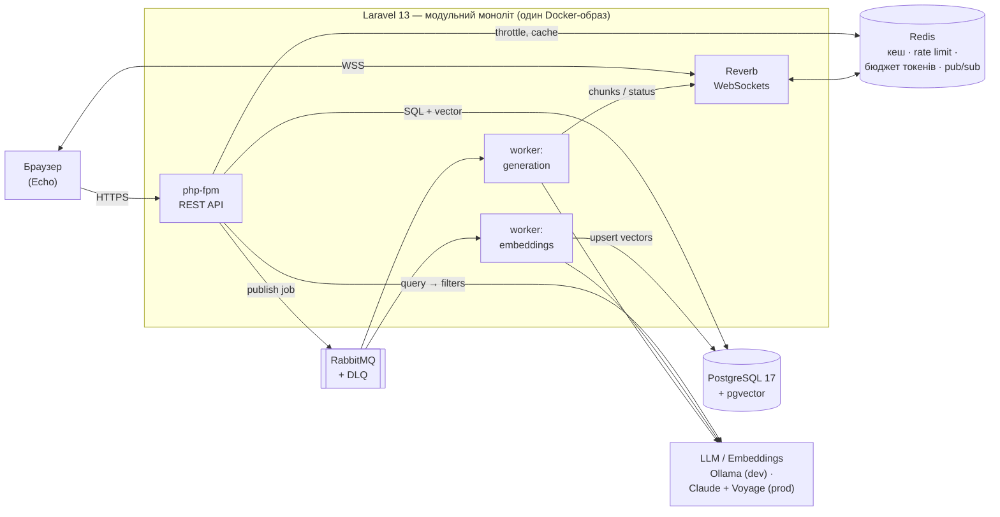
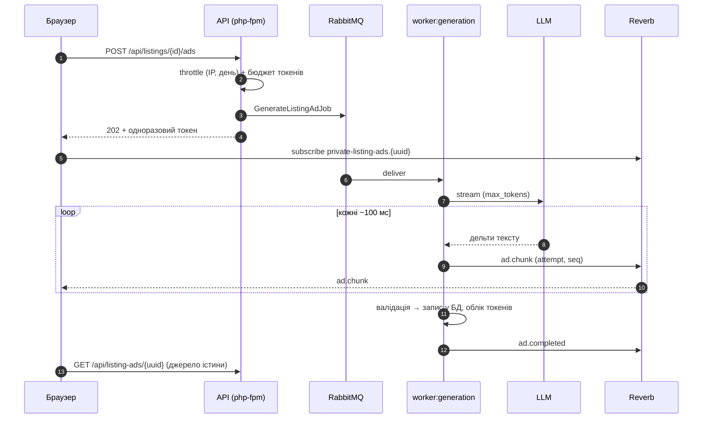

# Dwellio — AI-помічник для оренди житла в Києві

[](https://github.com/Vitaliy070516/dwellio/actions/workflows/ci.yml)


Пет-проєкт рівня Senior Backend: модульний моноліт на Laravel 13 з двома AI-сценаріями.

1. **Семантичний пошук квартир** за запитом природною мовою — *«тихо, біля метро, можна з котом, до 20 тисяч»*. LLM розкладає запит на жорсткі SQL-фільтри + семантичний залишок, далі hybrid search: `pgvector` (HNSW) + повнотекстовий пошук + `pg_trgm`, злиті через Reciprocal Rank Fusion.
2. **Генерація оголошень для OLX і rieltor.ua** у фоновому воркері зі стрімінгом тексту в браузер через WebSockets (Laravel Reverb).

Головна ідея дизайну: **AI — ненадійна і платна залежність**. Тому кожен виклик LLM має fallback, ретраї з межею, DLQ і бюджет у Redis — у токенах на кожну ціль і в доларах на весь сервіс. Пошук працює навіть тоді, коли AI повністю лежить.

> Статус: тиждень 1 з 6 (MVP локально). План — [`docs/roadmap.md`](docs/roadmap.md), архітектура — [`docs/architecture.md`](docs/architecture.md).

## Архітектура



### Генерація оголошення: послідовність



### Модулі

| Модуль | Відповідальність | Залежить від |
|---|---|---|
| `Listings` | Квартири: CRUD, індексація ембедингів | — |
| `Search` | Розбір запиту (Structured Output), hybrid search, RRF | `Listings`, `AI\Contracts` |
| `Generation` | Оголошення OLX / rieltor.ua, стрімінг, канали Reverb | `Listings`, `AI\Contracts` |
| `AI` | Контракти над LLM, адаптери `laravel/ai`, Fake-и, бюджет токенів | — |

Межі перевіряються Pest Architecture tests ([`tests/Architecture`](tests/Architecture)): `Search` не імпортує `Generation`, SDK LLM дозволено лише в `App\Modules\AI\Services`.

## Архітектурні рішення (ADR)

| ADR | Рішення | Коротко чому |
|---|---|---|
| [001](docs/adr/001-modular-monolith.md) | Модульний моноліт | Один деплой на 1 ГБ RAM; межі — тестами; масштабуємо процеси |
| [002](docs/adr/002-rabbitmq-for-ai-jobs.md) | RabbitMQ для AI-задач | DLQ, ack, безпечні 3-хвилинні Job-и; ланцюжок таймаутів |
| [003](docs/adr/003-pgvector-hybrid-search.md) | pgvector + RRF | Вектор і `WHERE` в одному SQL, без синхронізації з окремим store |
| [004](docs/adr/004-ai-sdk-choice.md) | Laravel AI SDK за власним контрактом | Ембединги Ollama, Fake-и, usage; SDK замінюється одним адаптером |
| [005](docs/adr/005-reverb-streaming-from-worker.md) | Reverb + стрімінг із воркера | php-fpm не тримає стрім; БД — джерело істини |

## Стек

**Backend:** PHP 8.4, Laravel 13, Laravel AI SDK, Laravel Reverb · **Дані:** PostgreSQL 17 + pgvector, Redis, RabbitMQ · **AI:** Ollama (`bge-m3`, `qwen2.5:3b`) локально за $0, Anthropic Claude + Voyage AI у проді, Fake-и в тестах · **Якість:** Pest (Feature / Unit / Architecture), PHPStan `level: max`, Pint · **DevOps:** Docker / Sail, GitHub Actions + GitLab CI, Terraform (AWS), k3d (тиждень 4) · **Observability:** Prometheus, Loki, Grafana (профіль `obs`).

## Швидкий старт

Потрібні Docker (на Windows — Docker Desktop з WSL2 Integration) і `make`. PHP, Composer і Node локально не потрібні: усе виконується в контейнерах Sail.

```bash
git clone git@github.com:Vitaliy070516/dwellio.git && cd dwellio
```

```bash
cp .env.example .env
```

```bash
docker run --rm -u "$(id -u):$(id -g)" -v "$(pwd):/var/www/html" -w /var/www/html laravelsail/php84-composer:latest composer install --ignore-platform-reqs
```

```bash
make up
```

```bash
./vendor/bin/sail artisan key:generate
```

```bash
./vendor/bin/sail artisan migrate --seed
```

```bash
make queue-setup
```

```bash
make build
```

За замовчуванням усі AI-драйвери — `fake` (детерміновані відповіді, без мережі й витрат). Щоб працювати з реальними моделями локально:

```bash
make up-ollama
```

і в `.env` виставити `AI_EMBEDDING_DRIVER=laravel-ai`, `AI_LLM_DRIVER=laravel-ai`, `AI_GENERATION_DRIVER=laravel-ai` (моделі `bge-m3` і `qwen2.5:3b` треба один раз завантажити в Ollama через `ollama pull`).

Фонові воркери окремими контейнерами:

```bash
make up-workers
```

| Що | Адреса |
|---|---|
| API | `http://localhost/api` |
| Демо: пошук і картка квартири з генерацією (потрібен `make build`) | `http://localhost/` |
| Health check | `http://localhost/up` |
| RabbitMQ UI | `http://localhost:15672` |

### Приклади API

```bash
curl -s "http://localhost/api/search?q=$(python3 -c 'import urllib.parse;print(urllib.parse.quote("тихо біля метро, можна з котом, до 20 тисяч"))')"
```

```bash
curl -s -X POST http://localhost/api/listings/1/ads -H 'Content-Type: application/json' -d '{"platform":"olx"}'
```

Відповідь пошуку містить `meta.mode` (`hybrid` / `text_only` / `filters_only`), `meta.parsed_by_llm` і `meta.degraded` (`{"query_parsing": "budget_exceeded", "embeddings": null}`) — клієнт бачить не лише режим деградації, а й причину.
Кожна квартира у видачі має `match`: які гілки її знайшли і на якій позиції (`{"matched_by": ["vector", "fts"], "ranks": {"vector": 7, "fts": 2}, "score": 0.047}`).

### Якість пошуку (офлайн-оцінка)

```bash
make search-eval c="--rrf-k=10,30,60 --candidates=20,50,100 --details"
```

На платних моделях (Anthropic / Voyage) команда вимагає `--force`: прогін витрачає спільний денний бюджет AI.

30 еталонних запитів (`resources/eval/search-golden-set.json`) → Recall@10 і MRR@10. На bge-m3 + qwen2.5:3b: **0.967 / 0.967** (базова лінія — 0.527 / 0.833). Головний виграш дали не параметри RRF, а боротьба з вигаданими фільтрами LLM: temperature 0, few-shot і перевірка, що кожен фільтр має опору в тексті запиту. Деталі — `docs/architecture.md`, День 9.

## Контроль витрат на AI (FinOps)

Три лінії захисту від рахунку з чотирма нулями:

| Лінія | Де | Що обмежує |
|---|---|---|
| Rate limit на IP | `throttle:search` (30/хв), `throttle:ad-generation` (5/хв) | Одного зловмисного клієнта |
| Глобальна денна стеля запитів | `ad-generation`: 200/день | Кількість дорогих генерацій |
| **Денний бюджет токенів** на кожну ціль | `AI\Contracts\TokenBudget`, Redis `ai:tokens:{date}:{purpose}:*` | Реальні гроші: input + output токени |
| **Стеля в $** (день $1 / місяць $10) на всі цілі разом | Ціни моделей у `dwellio.ai.pricing`, Redis `ai:cost:*` у мікродоларах | Гаманець: токени різних моделей коштують по-різному |

Бюджет живе в декораторах над AI-контрактами (`Budgeted*Client`), тож жоден виклик не може обійти облік — ні в проді, ні в тестах. Окремі бюджети для `embeddings`, `query_parsing`, `generation`: переіндексація не «з'їсть» генерацію. Локальні Ollama/Fake коштують $0 і $-стелею не блокуються; невідома платна модель рахується за навмисно дорогою fallback-ціною. `make ai-usage` показує токени і $ проти стель. Вичерпано → провайдера не викликаємо: пошук деградує до SQL/FTS, генерація відповідає `503` з `Retry-After`, Job-и йдуть у DLQ без ретраїв. Додатково — кеш розбору запитів і векторів запитів у Redis з нормалізованим ключем («Тихо, з котом!» = «тихо з котом»): повторний запит коштує $0, hit rate видно в `make search-stats`.

```bash
make ai-usage
```

```bash
make search-stats
```

## Якість і CI

```bash
make check
```

`make check` = Pint → PHPStan (`max`) → Pest, ті самі стадії в [`.github/workflows/ci.yml`](.github/workflows/ci.yml) і [`.gitlab-ci.yml`](.gitlab-ci.yml) (GitLab Free отримує коміти push-дзеркалом із GitHub Actions — pull-mirroring на Free недоступний). Окремий job перевіряє Terraform (`fmt` + `validate` без AWS-акаунта).

Тести покривають неочевидні збої: падіння LLM посеред стріму, невалідний JSON від моделі, обрив з'єднання без фінальної події, дублікати повідомлень у черзі, недоступність RabbitMQ і Reverb, вичерпаний бюджет токенів.

## Інфраструктура

- **Terraform** ([`terraform/`](terraform)): VPC з однією публічною підмережею без NAT, Security Group лише 80/443 (доступ адміністратора — SSM Session Manager, без SSH), EC2 `t3.micro` з IMDSv2 і зашифрованим gp3, Elastic IP, приватний S3-бакет для `pg_dump` (versioning, SSE, lifecycle 30 днів, TLS-only), IAM-роль інстансу з правом лише **писати** бекапи, AWS Budgets. Remote state — S3 з нативним lock-файлом.

```bash
make tf-validate
```

- **AWS** — з тижня 3, за [чеклистом безпечного старту](docs/architecture.md#4-план-на-тиждень-1-wsl2-ubuntu-усі-команди--через-sail): MFA на root, IAM least privilege, бюджетні алерти, `terraform destroy` після демо.
- **Kubernetes** — тиждень 4: Kustomize overlays, HPA, k3d.

## System Design & SRE

> Повна версія (SLO/SLI, бекапи з перевіреним restore, 100×) — тиждень 6. Поточні тези:

- **Деградація замість відмови:** LLM недоступна → пошук без LLM; немає ембедингів → FTS + trigram; Reverb недоступний → результат через `GET`.
- **SLI з логів:** кожна спроба генерації пише один JSON-рядок (`duration_ms`, `time_to_first_token_ms`, `outcome`, токени) — з нього в Loki будуються p95 TTFT і частка невдалих генерацій.
- **Вузькі місця при 100×:** php-fpm і воркери масштабуються горизонтально (HPA/KEDA за довжиною черги); Reverb — через Redis pub/sub; PostgreSQL — read replica для пошуку, далі окремий vector store; ліміти провайдера LLM — черга як буфер + бюджет токенів.
- **Відомі обмеження:** exactly-once для генерації немає (падіння воркера після відповіді LLM = повторна оплата); бюджет токенів м'який — паралельні виклики можуть перевищити ліміт на (воркери × `max_tokens`).

## Структура

```text
app/Modules/{Listings,Search,Generation,AI}/   # Actions, DTO, Http, Jobs, Models, Contracts, Services
app/Shared/                                    # спільне без залежностей від модулів
tests/{Feature,Unit,Architecture}/
docker/  compose.yaml                          # Sail; profiles: ollama, obs, workers
terraform/{modules,envs/prod}/
docs/{architecture.md,roadmap.md,adr/}
```
