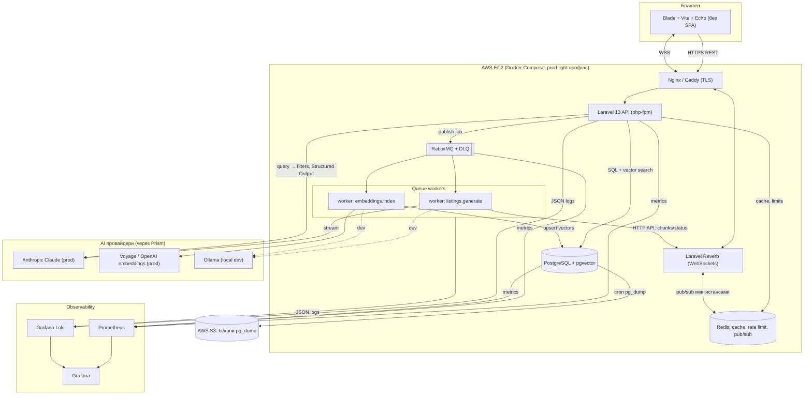

# Перший крок
У ролі **`[architect]`**:
1. Запропонуй високорівневу архітектуру системи (діаграма Mermaid, що показує взаємодію Laravel 13, PostgreSQL+pgvector, RabbitMQ, Redis, Reverb, Grafana Loki, Ollama/Anthropic та хмарної частини AWS EC2 + S3).
2. Склади оптимальну структуру директорій проєкту (модулі Laravel 13 + папки `/docker`, `/terraform`, `/k8s`, `.github/workflows`, `.gitlab-ci.yml`).
3. Розпиши покроковий план задач на **Тиждень 1** для запуску MVP під WSL2 (Ubuntu), включно з інструкцією щодо безпечного старту в AWS Free Tier та налаштування GitLab Mirroring.
---
 
# Dwellio — архітектура v0.2
 
Оновлено: 2026-11-16. Корінь проєкту: `~/projects/test-tasks/ai/dwellio` (у контейнері — `/var/www/html`).
Стек: PHP 8.4, Laravel 13 (вийшла 17.03.2026, мінімум PHP 8.3). Машина розробки: 16 ГБ RAM, Windows 11 + WSL2.
 
## 0. Поправки до початкових припущень
 
1. **AWS Free Tier уже не «12 місяців t2.micro».** Акаунт буде новий, тож діє кредитний Free Plan: $100 при реєстрації + до $100 за ознайомчі завдання, строк — 6 місяців або до вичерпання кредитів, після чого акаунт закривається, якщо не перейти на Paid plan. Висновок: акаунт створюємо на тижні 3–4, коли є що деплоїти.
2. **Pull-mirroring GitHub → GitLab недоступний на GitLab Free** (pull — лише Premium/Ultimate; безкоштовний тільки push з GitLab назовні). Заміна: job у GitHub Actions, який робить `git push` у GitLab після кожного коміту в `main`; GitLab CI стартує від цього пушу.
3. **Повний стек не вміститься в 1 ГБ RAM.** На EC2 йде профіль `prod-light` без локального observability (метрики й логи — у Grafana Cloud Free або лише локально/в k3d). Альтернатива — `t3.small` (2 ГБ) коштом кредитів; ціни перевірити в калькуляторі AWS.
4. **Laravel 13 має власний Laravel AI SDK і вбудовані можливості векторного пошуку.** Вибір «Prism чи Laravel AI SDK» фіксуємо окремим ADR на день 4 (див. розділ 5).
## 1. Високорівнева архітектура
 

 
## 2. Ключові рішення і trade-offs
 
| Рішення | Чому | Альтернатива і її ціна | При 100× |
|---|---|---|---|
| Модульний моноліт | Один деплой, чіткі межі модулів | Мікросервіси — оверхед без команди | Виносимо воркери й Reverb в окремі поди |
| RabbitMQ для AI-задач | DLQ, routing, ack/retry | Redis-черги простіші й для такого обсягу достатні | Окремі черги + HPA за довжиною черги |
| pgvector (HNSW) | Вектори й SQL-фільтри в одному запиті, одна БД | Qdrant — швидший, але +сервіс і синхронізація | RDS + read replica; після мільйонів векторів — окремий vector store |
| Hybrid search | Вектор + FTS, злиття через RRF, жорсткі фільтри у `WHERE` | Лише вектор — губить точні умови | Кеш ембедингів запитів у Redis |
| Reverb + стрімінг з воркера | HTTP-запит не тримає з'єднання з LLM | SSE простіший, але займає php-fpm воркер на весь стрім | Reverb горизонтально через Redis pub/sub |
 
**Пастки, закладені в дизайн**
 
- **Розмірність ембедингів.** Колонка `vector(N)` фіксована; локальна модель в Ollama і прод-модель мусять мати однакову розмірність (наприклад, `bge-m3` локально і прод-модель на 1024 — перевірити актуальні значення). Поруч із вектором зберігаємо `embedding_model`.
- **Українська в FTS.** Вбудованого словника в Postgres немає: `simple` + `pg_trgm`, семантику закриває вектор.
## 3. Структура директорій
 
```text
dwellio/
├── app/
│   ├── Modules/
│   │   ├── Listings/            # квартири, CRUD, фільтри
│   │   │   ├── Actions/  DTO/  Models/  Http/  Policies/
│   │   ├── Search/              # парсинг запиту, hybrid search, RRF
│   │   │   ├── Actions/  DTO/  Queries/  Http/
│   │   ├── Generation/          # оголошення OLX / rieltor.ua
│   │   │   ├── Actions/  DTO/  Jobs/  Events/  Prompts/  Http/
│   │   └── AI/                  # обгортка над LLM-клієнтом, облік токенів, ліміти
│   │       ├── Contracts/  Services/  Middleware/
│   └── Shared/                  # ValueObjects, Exceptions, Logging
├── config/  database/  routes/
├── tests/
│   ├── Feature/  Unit/  Architecture/
├── docker/
│   ├── php/  nginx/  postgres/  rabbitmq/
│   ├── prometheus/  loki/  grafana/
├── compose.yaml                 # dev через Sail (profiles: obs, ollama)
├── compose.prod.yaml            # prod-light для EC2
├── terraform/
│   ├── modules/{ec2,network,s3_backup,iam}/
│   └── envs/prod/
├── k8s/
│   ├── base/                    # Deployment, Service, Ingress, ConfigMap, PVC, HPA
│   └── overlays/{local,prod}/   # kustomize
├── .github/workflows/{ci.yml,mirror-gitlab.yml}
├── .gitlab-ci.yml
├── docs/{architecture.md,adr/,openapi.yaml}
├── phpstan.neon  Makefile  README.md
```
 
Межі модулів фіксують Pest Architecture tests: `Search` не імпортує `Generation`, а LLM-клієнт викликається лише з модуля `AI`.
 
## 4. План на тиждень 1 (WSL2 Ubuntu, усі команди — через Sail)

> Огляд усіх 6 тижнів — у [`docs/roadmap.md`](roadmap.md).
 
**День 1 — середовище**
- `.wslconfig` (16 ГБ RAM на машині): `memory=10GB`, `swap=4GB`, `processors` — половина ядер. Windows лишається ~6 ГБ.
- Laravel 13 + Sail у `~/projects/test-tasks/ai/dwellio`; `compose.yaml` з Postgres (`pgvector/pgvector`), Redis, RabbitMQ. Observability та Ollama — в окремих `profiles`.
- Larastan (рівень 8 → max), Pint, Pest, `Makefile`.

**День 2 — CI і дзеркало**
- `ci.yml`: Pint → PHPStan → Pest.
- GitLab Free: порожній проєкт, Project Access Token у GitHub Secrets, `mirror-gitlab.yml` з `git push --force` у GitLab.
- `.gitlab-ci.yml` з тими самими стадіями.

**День 3 — домен**
- Міграції: `listings`, `listing_embeddings` (`vector`, HNSW-індекс, `embedding_model`), сидер на 200–500 квартир.
- CRUD через Actions + DTO, перші Feature-тести.

**День 4 — AI-шар**
- ADR: Prism чи Laravel AI SDK. Драйвер через `.env` (Ollama локально, Fake у тестах).
- Job `IndexListingEmbedding` через RabbitMQ: retry з backoff, DLQ, ідемпотентність за хешем тексту.

**День 5 — пошук**
- `ParseSearchQuery` (Structured Output → DTO фільтрів) + hybrid search з RRF.
- Тести: невалідний JSON від LLM, порожній результат, падіння провайдера → fallback на чисті SQL-фільтри.

**День 6 — генерація і real-time**
- `GenerateListingAd` job → стрімінг → broadcast у приватний канал Reverb (чанки батчами по ~100 мс).
- Мінімальна сторінка з Echo.

*Як реалізовано (2026-11-26):*
- Потік: `POST /api/listings/{id}/ads` → запис `listing_ads` (queued) + Job у черзі `generation` → `202` з одноразовим токеном. Браузер підписується на `private-listing-ads.{uuid}` (guard `ad-token`, `POST /api/broadcasting/auth`), отримує `ad.started` / `ad.chunk` (`attempt`, `seq`) / `ad.completed` / `ad.failed`, фінальний текст бере `GET /api/listing-ads/{uuid}`. Джерело істини — БД, WebSocket нічого не гарантує.
- Воркер публікує події в Reverb через HTTP API (Pusher-протокол); Reverb одразу запущено зі scaling через Redis pub/sub, тож на тижні 4 досить збільшити `replicas`.
- Кожен процес — окремий контейнер: `reverb`, `worker-embeddings`, `worker-generation` (профіль `workers`).
- Ланцюжок таймаутів (має строго зростати, інакше деплой обриває стрім і RabbitMQ доставляє Job повторно = повторна оплата токенів):

| Ланка | Значення |
|---|---|
| LLM (`AI_GENERATION_TIMEOUT`, він же Guzzle `read_timeout` для стрімів) | 180 с |
| `GenerateListingAdJob::$timeout` (`failOnTimeout = true`) | 240 с |
| `queue:work --timeout` | 270 с |
| `stop_grace_period` у Compose / `terminationGracePeriodSeconds` у k8s | 300 с |
| TTL lock `WithoutOverlapping` | 300 с |

- AMQP heartbeat вимкнений навмисно: PHP-воркер синхронно читає стрім і не встигав би відповідати на heartbeat. `consumer_timeout` RabbitMQ (30 хв) > життя Job (15 хв).

*Known issues Дня 6:*
- Ліміти OLX / rieltor.ua у `Platform` не звірені з правилами майданчиків.
- `qwen2.5:3b` погано тримає формат і може вигадувати факти; у UI є попередження «перевірте факти».
- У повідомленнях scaling-каналу Redis Reverb передає серіалізований `Application` **разом із secret** → Redis у проді лише в приватній мережі й із паролем.
- CRUD квартир і запуск генерації без автентифікації (є лише throttle 5/хв на IP і 200/день глобально).
- Exactly-once немає: падіння воркера між відповіддю LLM і записом у БД = повторна оплата.

**День 7 — безпека і документація**
- Rate limiting і облік токенів у Redis, README з діаграмою, ADR-001…004.
- AWS цього тижня — лише підготовка: каркас Terraform (`terraform validate` без акаунта) і чеклист старту на тиждень 3–4.

*Як реалізовано (2026-11-26):*
- **Бюджет токенів:** контракт `AI\Contracts\TokenBudget` + `CacheTokenBudget` (Redis, атомарний `INCRBY`, ключі `ai:tokens:{Y-m-d UTC}:{purpose}:{input|output|calls}`, TTL 3 доби). Окремі денні ліміти на `embeddings` / `query_parsing` / `generation` (`AI_BUDGET_*_DAILY`). Кожен AI-контракт резолвиться в `Budgeted*Client`-декоратор над адаптером або Fake: перевірка ДО виклику, облік ПІСЛЯ. `StructuredOutputClient` тепер повертає DTO `StructuredOutput` з токенами.
- **Поведінка при вичерпанні:** пошук — fallback без LLM / без вектора; `POST /ads` — `503` + `Retry-After` до півночі UTC (перевірка до постановки Job); Job-и генерації та індексації — одразу `failed` без ретраїв (`AdFailure::BudgetExceeded`, DLQ), індексацію наздоганяє `listings:reindex`.
- **Rate limit пошуку:** `throttle:search`, 30/хв на IP (`SEARCH_RATE_PER_MINUTE`). `make ai-usage` — таблиця споживання за день.
- **Terraform:** `terraform/modules/{network,iam,ec2,s3_backup}` + `envs/prod` (S3 backend з `use_lockfile`, AWS Budgets). `make tf-validate` у Docker; job `terraform` у GitHub Actions і GitLab CI.
- **Документи:** ADR-001, 002, 003, 005; README з діаграмами Mermaid.

*Known issues Дня 7:*
- Бюджет м'який («перевірив → викликав → дописав»): перевищення до (одночасні виклики × `max_tokens`). Жорсткий варіант — резервування `max_tokens` до виклику.
- Обірваний стрім токенів не повертає (usage приходить у фінальній події) → такі витрати не потрапляють у лічильник, видно лише в логах спроб.
- ~~Ліміти в токенах, а не в грошах~~ — закрито на Дні 8 (стеля в $).

**Чеклист безпечного старту в AWS (тиждень 3–4, новий акаунт на Free Plan)**
1. Реєстрація на Free Plan; root — лише для білінгу, одразу MFA.
2. IAM Identity Center або IAM-користувач із least privilege для Terraform; жодних access keys у root.
3. AWS Budgets: алерт на витрату кредитів (поріг $1 фактичних витрат + алерти на 50/80% кредитів).
4. Remote state Terraform у S3 з шифруванням і versioning.
5. `terraform destroy` після демо, щоб кредитів вистачило на всі 6 місяців.
## 4.1 План на тиждень 2 (дні 8–14): завершення MVP

> DoD тижня (з `docs/roadmap.md`): MVP можна показати з локальної машини через тунель; витрати AI видно в $; OpenAPI/Swagger UI; README v1. AWS — лише на тижні 3.

**День 8 — витрати AI у доларах**
- Таблиця цін моделей у конфігу (USD за 1M токенів input/output), Ollama і Fake — $0.
- Облік вартості кожного виклику в Redis (мікродолари, атомарний `INCRBY`) поруч із токенами.
- Спільна денна і місячна стеля в $ для всіх цілей (запобіжник поверх токенних лімітів); `ai:usage` показує $.

*Як реалізовано (2026-11-26):*
- **Ціни:** `dwellio.ai.pricing` — USD за 1M токенів по ID моделі (Haiku 5.5 $0.10/$0.50, Sonnet 5.5 $2/$10, voyage-4 $0.06). `PriceCatalog` обирає ціну для кожної цілі за `driver/provider/model` один раз на процес: `fake` і `ollama` — $0, невідома платна модель — навмисно дорогий `fallback` ($4/$20) + warning у лог.
- **Облік:** `CacheTokenBudget::record()` додає вартість у мікродоларах (`токени × $/1M` = µ$, ціле число, `INCRBY` без похибок float; округлення вгору). Ключі `ai:cost:{Y-m-d}:{purpose}:usd_micros` (TTL 3 доби) і `ai:cost:{Y-m}:usd_micros` (TTL 40 діб). Читання — одним `MGET` (`Cache::many`).
- **Стелі:** `AI_BUDGET_USD_DAILY` ($1) і `AI_BUDGET_USD_MONTHLY` ($10) — спільні для всіх цілей. Порядок перевірки: токени цілі → місяць → день. Безкоштовні виклики $-стелею не блокуються, тож `0` = аварійний вимикач платних викликів без зупинки локальної Ollama. Виняток той самий (`TokenBudgetExceededException`) з новим полем `limit` (`BudgetLimit`): усі наявні fallback-и працюють без змін, `Retry-After` — до півночі UTC або до 1-го числа.
- **`make ai-usage`:** колонка `cost` по цілях + таблиця «день / місяць проти стелі».

*Known issues Дня 8:*
- Ціни зашиті в конфіг і застаріють — звірка вручну при зміні моделі (дата перевірки в коментарі). Знижки prompt caching / Batch і безкоштовні токени Voyage не враховано → оцінка зверху.
- Обірваний стрім і далі не потрапляє в лічильник (токенів немає → немає й $), див. Known issues Дня 7.
- $-стеля — запобіжник застосунку, а не білінгу: правду показує консоль провайдера, тому ліміти витрат треба також виставити в Anthropic Console / Voyage dashboard (тиждень 3, разом з AWS Budgets).

**День 9 — полірування пошуку**
- Кеш `ParseSearchQuery` і ембедингу запиту вже є (ключ — `mb_strtolower`): нормалізувати ключ глибше (пробіли, пунктуація, порядок слів не чіпаємо) і рахувати hit rate — повторний запит = $0.
- Golden set ~30 запитів + команда `search:eval` (Recall@10, MRR) — підбір `rrf_k` і `candidates` цифрами, а не на око.
- Пояснення збігу у відповіді (`matched_by`: vector / fts / trigram) для демо й дебагу.

*Як реалізовано (2026-11-26):*
- **Ключ кешу:** `QueryNormalizer` (потребує `ext-intl`, оголошено в `composer.json`, щоб образ без нього не зібрався) — NFKC, нижній регістр, 5 варіантів апострофа → `'`, усі тире → `-`, пунктуація → пробіл (крім `' - /` усередині слова чи числа: «п'ять», «1-2», «2/3»), стиснення пробілів. Порядок слів і групування цифр («20 000» ≠ «20000») не чіпаємо: хибне влучання віддає чужі фільтри, а промах коштує соту частку цента. У LLM іде оригінальний текст. Ключ розбору містить `PARSER_VERSION` (промпт + схема + правила grounding).
- **Hit rate:** `SearchCacheStats` — денні лічильники `search:cache:{date}:{parsed_query|query_embedding}:{hits|misses}` (TTL 3 доби, `add` + `INCRBY`, читання одним `MGET`). `make search-stats` показує hit rate за день. `search:eval` облік вимикає, щоб не спотворювати реальну цифру.
- **`matched_by`:** RRF-запит у тому самому проході збирає `json_object_agg(гілка, позиція)`. Кожен елемент `data` отримує `match: {matched_by: [vector, fts, trigram], ranks: {vector: 7, fts: 2}, score}`; у режимі `filters_only` — `null`.
- **Golden set:** `resources/eval/search-golden-set.json`, 30 запитів: сленг, рос./англ., одруківки, збірні назви («лівий берег», «центр»), діапазони цін. Релевантність задано правилом (фільтри + групи слів зі словника `ListingFactory`), а не списком id, тож воно переживає `migrate:fresh --seed`. `make search-eval c="--rrf-k=10,30,60 --candidates=20,50,100 --details"`; метрики: Recall@10 (з обмеженням `min(|R|, k)`) і MRR@10; `--min-mrr` — регресійний поріг. На платних моделях команда відмовляється працювати без `--force`: перший прогін робить до 2 викликів на запит зі спільного з користувачами денного бюджету. Ціну команда бачить через вузький контракт `AI\Contracts\AiPricing` (лише читання), а не через `TokenBudget`, бо записувати витрати можуть лише Budget-декоратори (Architecture test).

*Що показали цифри (bge-m3 + qwen2.5:3b, 275 активних квартир):*

| Крок | Recall@10 | MRR@10 |
|---|---|---|
| Базова лінія (Дні 5–8) | 0.527 | 0.833 |
| + temperature 0 і few-shot у промпті розбору | 0.841 | 0.933 |
| + `FilterGrounding` (фільтр має опору в тексті запиту) | 0.957 | 0.967 |
| + приклади, що не перетинаються з еталоном; межа слова в grounding (після `[review]`) | **0.967** | **0.967** |

*Рядки 2–3 поміряно з few-shot прикладами, які майже дослівно повторювали два запити еталона (знахідка `[review]`). Після заміни прикладів цифри не впали, тож витік їх не завищував, але міряти треба саме так.*

- **`rrf_k` і `candidates` майже не впливають:** на базовій лінії MRR = 0.833 в усіх 20 точках сітки (`rrf_k` 1…100 × `candidates` 10…100), Recall коливається в межах ±0.02. Обидва параметри лишаються з цифрами на підтримку: `rrf_k = 60` (від 30 і вище плато), `candidates = 50` (100 гірше на 0.03: глибокі слабкі кандидати набирають RRF-масу з двох-трьох гілок і витісняють сильні збіги однієї).
- **Справжнє вузьке місце — LLM-парсер.** qwen2.5:3b вигадував `districts: [shevchenkivskyi]` і `rooms` у запитах, де про них ні слова, «до 15 тисяч» робив `price_min`, «5 хвилин пішки» — `price_max: 500`. Вигаданий жорсткий фільтр мовчки викидає з видачі все релевантне. Виправлення: `StructuredOutputAgent` з temperature 0 і `max_tokens` 500 (той самий запит → ті самі фільтри), few-shot приклади, і `FilterGrounding`: район приймається лише тоді, коли його основа є в тексті (укр./рос., відмінки, збірні назви), кімнати, метро, тварини й меблі — коли є ключове слово, ціна — коли збігається з числом у запиті (X або X × 1000). Напрям ціни визначають слова «від/до». Відкинуті поля пишемо в лог (`info`) як сигнал якості моделі.
- **Внесок гілок** (релевантні в топ-10, один результат може мати кілька гілок): vector 243, trigram 165, FTS 134. Кожна гілка щось додає, жодну не можна прибрати без втрат.

*Known issues Дня 9:*
- **Golden set написано тим самим автором, що й виправлення** → ризик підгонки під еталон (дві правки grounding зроблено саме за його провалами). Few-shot приклади навмисно не перетинаються з еталоном (коментар біля `PARSER_VERSION`). Потрібен відкладений набір із запитів реальних користувачів (після демо, День 12+). Дані синтетичні: тексти з шаблонів factory, тож метрики оптимістичніші, ніж на справжніх оголошеннях.
- **«Біля метро Лук'янівська» = 0:** «біля метро» → жорсткий фільтр ≤ 500 м, а всі 5 квартир біля цієї станції далі за 550 м. Це питання дизайну, а не баг: відстань до метро варто зробити м'яким бустом ранжування, а не `WHERE`. Кандидат на тиждень 5.
- `PARSER_VERSION` треба піднімати вручну після кожної зміни промпту чи grounding: інакше протягом TTL (1 год) віддаються розбори за старими правилами. Під час розробки на цьому й спіткнулися. Автоматична альтернатива — хеш тексту інструкцій у ключі.
- Grounding — словник основ: новий район чи сленг («Троя», «Лісовий») потребує правки коду. Для Haiku в проді grounding — страховка, а не основний механізм; цифри для Haiku поміряємо на тижні 3, коли з'явиться ключ.
- Облік hit rate додає 4 команди Redis на пошук (`add` + `INCRBY` × 2 кеші). Зараз це непомітно; на тижні 3 — pipeline або Prometheus-лічильники в пам'яті процесу.
- Hit rate рахується за запитами, а не за $: «зекономлені $» потребують середньої ціни виклику (є в `ai:usage`), об'єднаємо в Grafana на тижні 3.

**День 10 — демо-фронт**
- Сторінка пошуку і картка квартири з кнопкою генерації OLX / rieltor.ua (Blade + Vite + Echo, без SPA-фреймворку).
- Видимі стани деградації: «пошук без AI», «бюджет вичерпано», обрив WebSocket → дочитування через `GET`.

*Як реалізовано (2026-11-26):*
- **Шар `App\Web`** (`SearchPageController`, `ListingPageController`) лише компонує модулі: картці квартири потрібні і `Listings`, і `Platform` з `Generation`, а `Listings` за ADR-001 ні від кого не залежить. Architecture tests: жоден модуль не імпортує `App\Web`; сам шар не чіпає `DB`, `AI` і Actions із побічними ефектами.
- **`/` — пошук.** Blade віддає лише форму і `<template>` картки, результати JS бере з публічного `GET /api/search`: демо-фронт є звичайним клієнтом API (той самий контракт піде в OpenAPI на Дні 11). Параметри дублюються в URL (`/?q=…`): видачу можна переслати, «Назад» з картки повертає на неї. Новий пошук скасовує попередній через `AbortController`, щоб повільна стара відповідь не перезаписала свіжу. Показуємо «AI зрозумів: до 20 000 грн · Подільський р-н · за змістом: «…»» і бейджі `matched_by` («за змістом #3», «за словами #10»).
- **`/listings/{id}` — картка.** Дані рендерить Blade (екранування `{{ }}`, тест на XSS), дві кнопки генерації OLX / rieltor.ua. Чернетки, архів і видалені — 404, як в API. `/ads/demo` Дня 6 тепер редиректить на `/`.
- **Причина деградації в API:** `meta.degraded = {query_parsing, embeddings}` зі значеннями `provider_unavailable` / `invalid_output` / `budget_exceeded` / `null` (enum `Search\Enums\DegradationReason`). `mode` каже, *як* виконано пошук, `degraded` — *чому*: `text_only` через бюджет і через падіння провайдера фронт показує по-різному. Кешований розбір під вичерпаним бюджетом деградацією не вважається: LLM не знадобилась.
- **Видимі стани:** пошук — банери `budget` / `no-ai` / `no-semantic` / `filters-only` / `rate-limit` / `error`; генерація — `503` + `Retry-After` = «бюджет вичерпано, спробуйте за N год», `503` без нього = черга недоступна, `409` / `429` / `404`, `failed` з людським текстом за `failure_code`. Бейдж стану WebSocket видно завжди («наживо» / «з'єднання втрачено · дочитую через GET» / «недоступний · оновлення через GET»). Поки WebSocket не підключений, GET-опитування частішає з 10 до 3 с; після перепідключення одразу робимо знімок. Готовий текст можна скопіювати.
- Перевірено на Ollama: перший запит упав на холодному старті qwen (`degraded.query_parsing = provider_unavailable`, пошук відпрацював гібридно без фільтрів), другий розібрано повністю (`filters_only`, 26 с).

*Known issues Дня 10:*
- **JS без тестів.** Pest перевіряє контракт сторінок і `meta.degraded`, а логіку станів (`seq`, перепідключення, гонка відповідей) — ні. Кандидат: Pest Browser plugin (Playwright) на Дні 13 або на тижні 5. У цій сесії сторінки не відкривали в браузері (розширення недоступне), перевірено `curl` + Vite build.
- **Розрізнення помилок генерації за `Retry-After`** — тимчасовий хак: машиночитний `code` з'явиться в єдиному форматі помилок на Дні 11.
- **Перезавантаження сторінки губить генерацію:** токен доступу живе лише в пам'яті JS. Можна покласти `{ad_id, token}` у `sessionStorage` (токен відкриває лише одну генерацію), але це ще одне місце для токена → вирішимо разом із `DEMO_MODE`.
- **Холодний старт Ollama тримає `GET /api/search` до ~2 хв** (php-fpm воркер зайнятий весь час). Для локалки прийнятно; для демо через тунель (День 12) треба менший таймаут розбору запиту і прогрів моделі при старті.
- `listing.js` важить ~100 кБ (28 кБ gzip) через `pusher-js`; сторінка пошуку Echo не вантажить.

**День 11 — OpenAPI / Swagger UI**
- Генерація специфікації з коду (FormRequest/Resource) + Swagger UI на `/docs/api`.
- Єдиний формат помилок; CI-перевірка, що закомічена специфікація збігається зі згенерованою.

**День 12 — демо-доступ через тунель**
- Cloudflare Tunnel у Compose-профілі `demo`; Reverb (wss) через той самий хост.
- `DEMO_MODE`: CRUD квартир вимкнено (лише пошук і генерація), жорсткіші ліміти, `APP_DEBUG=false`, кеш конфігу.

**День 13 — `[review]` + `[qa]` MVP**
- Прохід по N+1, таймаутах і abuse-сценаріях демо; тести на `DEMO_MODE` і деградацію фронту.
- Нові знахідки — у known issues (повний прохід — тиждень 5).

**День 14 — README v1 і буфер**
- README v1: запуск, демо-посилання, скріншоти, FinOps-розділ (бюджети в токенах і $).
- Буфер на хвости тижня; деталізація тижня 3 в цьому файлі.

## 5. Відкриті питання (ADR)
 
- ~~ADR-001: модульний моноліт.~~ Прийнято.
- ~~ADR-002: RabbitMQ проти Redis-черг.~~ Прийнято.
- ~~ADR-003: pgvector проти окремого vector store.~~ Прийнято.
- ~~ADR-004: Prism проти Laravel AI SDK (Laravel 13).~~ Прийнято.
- ADR-005: Reverb і стрімінг із воркера (номер зайнято на Дні 6, див. `docs/adr/README.md`).
- ADR-006: `t3.micro` + swap проти `t3.small` на кредитах (тиждень 3).
## Джерела
 
- AWS: https://aws.amazon.com/about-aws/whats-new/2025/07/aws-free-tier-credits-month-free-plan
- GitLab mirroring: https://docs.gitlab.com/17.2/ee/user/project/repository/mirror
- Laravel 13 release notes: https://laravel.com/docs/13.x/releases
