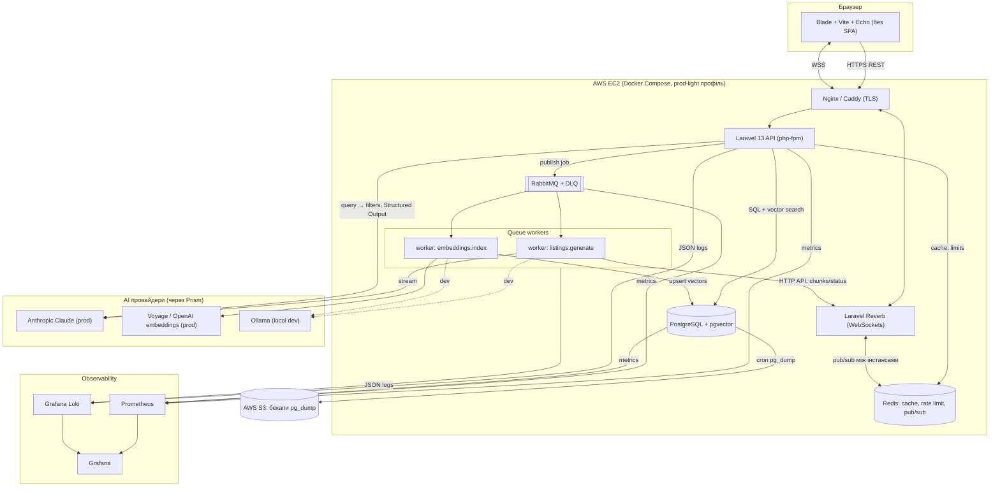

# Перший крок
У ролі **`[architect]`**:
1. Запропонуй високорівневу архітектуру системи (діаграма Mermaid, що показує взаємодію Laravel 13, PostgreSQL+pgvector, RabbitMQ, Redis, Reverb, Grafana Loki, Ollama/Anthropic та хмарної частини AWS EC2 + S3).
2. Склади оптимальну структуру директорій проєкту (модулі Laravel 13 + папки `/docker`, `/terraform`, `/k8s`, `.github/workflows`, `.gitlab-ci.yml`).
3. Розпиши покроковий план задач на **Тиждень 1** для запуску MVP під WSL2 (Ubuntu), включно з інструкцією щодо безпечного старту в AWS Free Tier та налаштування GitLab Mirroring.
---
 
# Dwellio — архітектура v0.2
 
Оновлено: 2026-11-16. Корінь проєкту: `~/projects/test-tasks/ai/dwellio` (у контейнері — `/var/www/html`).
Стек: PHP 8.4, Laravel 13 (вийшла 17.03.2026, мінімум PHP 8.3). Машина розробки: 16 ГБ RAM, Windows 11 + WSL2.
 
## 0. Поправки до початкових припущень
 
1. **AWS Free Tier уже не «12 місяців t2.micro».** Акаунт буде новий, тож діє кредитний Free Plan: $100 при реєстрації + до $100 за ознайомчі завдання, строк — 6 місяців або до вичерпання кредитів, після чого акаунт закривається, якщо не перейти на Paid plan. Висновок: акаунт створюємо на тижні 3–4, коли є що деплоїти.
2. **Pull-mirroring GitHub → GitLab недоступний на GitLab Free** (pull — лише Premium/Ultimate; безкоштовний тільки push з GitLab назовні). Заміна: job у GitHub Actions, який робить `git push` у GitLab після кожного коміту в `main`; GitLab CI стартує від цього пушу.
3. **Повний стек не вміститься в 1 ГБ RAM.** На EC2 йде профіль `prod-light` без локального observability (метрики й логи — у Grafana Cloud Free або лише локально/в k3d). Альтернатива — `t3.small` (2 ГБ) коштом кредитів; ціни перевірити в калькуляторі AWS.
4. **Laravel 13 має власний Laravel AI SDK і вбудовані можливості векторного пошуку.** Вибір «Prism чи Laravel AI SDK» фіксуємо окремим ADR на день 4 (див. розділ 5).
## 1. Високорівнева архітектура
 

 
## 2. Ключові рішення і trade-offs
 
| Рішення | Чому | Альтернатива і її ціна | При 100× |
|---|---|---|---|
| Модульний моноліт | Один деплой, чіткі межі модулів | Мікросервіси — оверхед без команди | Виносимо воркери й Reverb в окремі поди |
| RabbitMQ для AI-задач | DLQ, routing, ack/retry | Redis-черги простіші й для такого обсягу достатні | Окремі черги + HPA за довжиною черги |
| pgvector (HNSW) | Вектори й SQL-фільтри в одному запиті, одна БД | Qdrant — швидший, але +сервіс і синхронізація | RDS + read replica; після мільйонів векторів — окремий vector store |
| Hybrid search | Вектор + FTS, злиття через RRF, жорсткі фільтри у `WHERE` | Лише вектор — губить точні умови | Кеш ембедингів запитів у Redis |
| Reverb + стрімінг з воркера | HTTP-запит не тримає з'єднання з LLM | SSE простіший, але займає php-fpm воркер на весь стрім | Reverb горизонтально через Redis pub/sub |
 
**Пастки, закладені в дизайн**
 
- **Розмірність ембедингів.** Колонка `vector(N)` фіксована; локальна модель в Ollama і прод-модель мусять мати однакову розмірність (наприклад, `bge-m3` локально і прод-модель на 1024 — перевірити актуальні значення). Поруч із вектором зберігаємо `embedding_model`.
- **Українська в FTS.** Вбудованого словника в Postgres немає: `simple` + `pg_trgm`, семантику закриває вектор.
## 3. Структура директорій
 
```text
dwellio/
├── app/
│   ├── Modules/
│   │   ├── Listings/            # квартири, CRUD, фільтри
│   │   │   ├── Actions/  DTO/  Models/  Http/  Policies/
│   │   ├── Search/              # парсинг запиту, hybrid search, RRF
│   │   │   ├── Actions/  DTO/  Queries/  Http/
│   │   ├── Generation/          # оголошення OLX / rieltor.ua
│   │   │   ├── Actions/  DTO/  Jobs/  Events/  Prompts/  Http/
│   │   └── AI/                  # обгортка над LLM-клієнтом, облік токенів, ліміти
│   │       ├── Contracts/  Services/  Middleware/
│   └── Shared/                  # ValueObjects, Exceptions, Logging
├── config/  database/  routes/
├── tests/
│   ├── Feature/  Unit/  Architecture/
├── docker/
│   ├── php/  nginx/  postgres/  rabbitmq/
│   ├── prometheus/  loki/  grafana/
├── compose.yaml                 # dev через Sail (profiles: obs, ollama)
├── compose.prod.yaml            # prod-light для EC2
├── terraform/
│   ├── modules/{ec2,network,s3_backup,iam}/
│   └── envs/prod/
├── k8s/
│   ├── base/                    # Deployment, Service, Ingress, ConfigMap, PVC, HPA
│   └── overlays/{local,prod}/   # kustomize
├── .github/workflows/{ci.yml,mirror-gitlab.yml}
├── .gitlab-ci.yml
├── docs/{architecture.md,adr/,openapi.json}
├── phpstan.neon  Makefile  README.md
```
 
Межі модулів фіксують Pest Architecture tests: `Search` не імпортує `Generation`, а LLM-клієнт викликається лише з модуля `AI`.
 
## 4. План на тиждень 1 (WSL2 Ubuntu, усі команди — через Sail)

> Огляд усіх 6 тижнів — у [`docs/roadmap.md`](roadmap.md).
 
**День 1 — середовище**
- `.wslconfig` (16 ГБ RAM на машині): `memory=10GB`, `swap=4GB`, `processors` — половина ядер. Windows лишається ~6 ГБ.
- Laravel 13 + Sail у `~/projects/test-tasks/ai/dwellio`; `compose.yaml` з Postgres (`pgvector/pgvector`), Redis, RabbitMQ. Observability та Ollama — в окремих `profiles`.
- Larastan (рівень 8 → max), Pint, Pest, `Makefile`.

**День 2 — CI і дзеркало**
- `ci.yml`: Pint → PHPStan → Pest.
- GitLab Free: порожній проєкт, Project Access Token у GitHub Secrets, `mirror-gitlab.yml` з `git push --force` у GitLab.
- `.gitlab-ci.yml` з тими самими стадіями.

**День 3 — домен**
- Міграції: `listings`, `listing_embeddings` (`vector`, HNSW-індекс, `embedding_model`), сидер на 200–500 квартир.
- CRUD через Actions + DTO, перші Feature-тести.

**День 4 — AI-шар**
- ADR: Prism чи Laravel AI SDK. Драйвер через `.env` (Ollama локально, Fake у тестах).
- Job `IndexListingEmbedding` через RabbitMQ: retry з backoff, DLQ, ідемпотентність за хешем тексту.

**День 5 — пошук**
- `ParseSearchQuery` (Structured Output → DTO фільтрів) + hybrid search з RRF.
- Тести: невалідний JSON від LLM, порожній результат, падіння провайдера → fallback на чисті SQL-фільтри.

**День 6 — генерація і real-time**
- `GenerateListingAd` job → стрімінг → broadcast у приватний канал Reverb (чанки батчами по ~100 мс).
- Мінімальна сторінка з Echo.

*Як реалізовано (2026-11-26):*
- Потік: `POST /api/listings/{id}/ads` → запис `listing_ads` (queued) + Job у черзі `generation` → `202` з одноразовим токеном. Браузер підписується на `private-listing-ads.{uuid}` (guard `ad-token`, `POST /api/broadcasting/auth`), отримує `ad.started` / `ad.chunk` (`attempt`, `seq`) / `ad.completed` / `ad.failed`, фінальний текст бере `GET /api/listing-ads/{uuid}`. Джерело істини — БД, WebSocket нічого не гарантує.
- Воркер публікує події в Reverb через HTTP API (Pusher-протокол); Reverb одразу запущено зі scaling через Redis pub/sub, тож на тижні 4 досить збільшити `replicas`.
- Кожен процес — окремий контейнер: `reverb`, `worker-embeddings`, `worker-generation` (профіль `workers`).
- Ланцюжок таймаутів (має строго зростати, інакше деплой обриває стрім і RabbitMQ доставляє Job повторно = повторна оплата токенів):

| Ланка | Значення |
|---|---|
| LLM (`AI_GENERATION_TIMEOUT`, він же Guzzle `read_timeout` для стрімів) | 180 с |
| `GenerateListingAdJob::$timeout` (`failOnTimeout = true`) | 240 с |
| `queue:work --timeout` | 270 с |
| `stop_grace_period` у Compose / `terminationGracePeriodSeconds` у k8s | 300 с |
| TTL lock `WithoutOverlapping` | 300 с |

- AMQP heartbeat вимкнений навмисно: PHP-воркер синхронно читає стрім і не встигав би відповідати на heartbeat. `consumer_timeout` RabbitMQ (30 хв) > життя Job (15 хв).

*Known issues Дня 6:*
- Ліміти OLX / rieltor.ua у `Platform` не звірені з правилами майданчиків.
- `qwen2.5:3b` погано тримає формат і може вигадувати факти; у UI є попередження «перевірте факти».
- У повідомленнях scaling-каналу Redis Reverb передає серіалізований `Application` **разом із secret** → Redis у проді лише в приватній мережі й із паролем.
- CRUD квартир і запуск генерації без автентифікації (є лише throttle 5/хв на IP і 200/день глобально).
- Exactly-once немає: падіння воркера між відповіддю LLM і записом у БД = повторна оплата.

**День 7 — безпека і документація**
- Rate limiting і облік токенів у Redis, README з діаграмою, ADR-001…004.
- AWS цього тижня — лише підготовка: каркас Terraform (`terraform validate` без акаунта) і чеклист старту на тиждень 3–4.

*Як реалізовано (2026-11-26):*
- **Бюджет токенів:** контракт `AI\Contracts\TokenBudget` + `CacheTokenBudget` (Redis, атомарний `INCRBY`, ключі `ai:tokens:{Y-m-d UTC}:{purpose}:{input|output|calls}`, TTL 3 доби). Окремі денні ліміти на `embeddings` / `query_parsing` / `generation` (`AI_BUDGET_*_DAILY`). Кожен AI-контракт резолвиться в `Budgeted*Client`-декоратор над адаптером або Fake: перевірка ДО виклику, облік ПІСЛЯ. `StructuredOutputClient` тепер повертає DTO `StructuredOutput` з токенами.
- **Поведінка при вичерпанні:** пошук — fallback без LLM / без вектора; `POST /ads` — `503` + `Retry-After` до півночі UTC (перевірка до постановки Job); Job-и генерації та індексації — одразу `failed` без ретраїв (`AdFailure::BudgetExceeded`, DLQ), індексацію наздоганяє `listings:reindex`.
- **Rate limit пошуку:** `throttle:search`, 30/хв на IP (`SEARCH_RATE_PER_MINUTE`). `make ai-usage` — таблиця споживання за день.
- **Terraform:** `terraform/modules/{network,iam,ec2,s3_backup}` + `envs/prod` (S3 backend з `use_lockfile`, AWS Budgets). `make tf-validate` у Docker; job `terraform` у GitHub Actions і GitLab CI.
- **Документи:** ADR-001, 002, 003, 005; README з діаграмами Mermaid.

*Known issues Дня 7:*
- Бюджет м'який («перевірив → викликав → дописав»): перевищення до (одночасні виклики × `max_tokens`). Жорсткий варіант — резервування `max_tokens` до виклику.
- Обірваний стрім токенів не повертає (usage приходить у фінальній події) → такі витрати не потрапляють у лічильник, видно лише в логах спроб.
- ~~Ліміти в токенах, а не в грошах~~ — закрито на Дні 8 (стеля в $).

**Чеклист безпечного старту в AWS (тиждень 3–4, новий акаунт на Free Plan)** — розгорнуто в `docs/runbooks/aws-account-setup.md` (День 15)
1. Реєстрація на Free Plan; root — лише для білінгу, одразу MFA.
2. IAM Identity Center або IAM-користувач із least privilege для Terraform; жодних access keys у root.
3. AWS Budgets: алерт на витрату кредитів (поріг $1 фактичних витрат + алерти на 50/80% кредитів).
4. Remote state Terraform у S3 з шифруванням і versioning.
5. `terraform destroy` після демо, щоб кредитів вистачило на всі 6 місяців.
## 4.1 План на тиждень 2 (дні 8–14): завершення MVP

> DoD тижня (з `docs/roadmap.md`): MVP можна показати з локальної машини через тунель; витрати AI видно в $; OpenAPI/Swagger UI; README v1. AWS — лише на тижні 3.

**День 8 — витрати AI у доларах**
- Таблиця цін моделей у конфігу (USD за 1M токенів input/output), Ollama і Fake — $0.
- Облік вартості кожного виклику в Redis (мікродолари, атомарний `INCRBY`) поруч із токенами.
- Спільна денна і місячна стеля в $ для всіх цілей (запобіжник поверх токенних лімітів); `ai:usage` показує $.

*Як реалізовано (2026-11-26):*
- **Ціни:** `dwellio.ai.pricing` — USD за 1M токенів по ID моделі (Haiku 5.5 $0.10/$0.50, Sonnet 5.5 $2/$10, voyage-4 $0.06). `PriceCatalog` обирає ціну для кожної цілі за `driver/provider/model` один раз на процес: `fake` і `ollama` — $0, невідома платна модель — навмисно дорогий `fallback` ($4/$20) + warning у лог.
- **Облік:** `CacheTokenBudget::record()` додає вартість у мікродоларах (`токени × $/1M` = µ$, ціле число, `INCRBY` без похибок float; округлення вгору). Ключі `ai:cost:{Y-m-d}:{purpose}:usd_micros` (TTL 3 доби) і `ai:cost:{Y-m}:usd_micros` (TTL 40 діб). Читання — одним `MGET` (`Cache::many`).
- **Стелі:** `AI_BUDGET_USD_DAILY` ($1) і `AI_BUDGET_USD_MONTHLY` ($10) — спільні для всіх цілей. Порядок перевірки: токени цілі → місяць → день. Безкоштовні виклики $-стелею не блокуються, тож `0` = аварійний вимикач платних викликів без зупинки локальної Ollama. Виняток той самий (`TokenBudgetExceededException`) з новим полем `limit` (`BudgetLimit`): усі наявні fallback-и працюють без змін, `Retry-After` — до півночі UTC або до 1-го числа.
- **`make ai-usage`:** колонка `cost` по цілях + таблиця «день / місяць проти стелі».

*Known issues Дня 8:*
- Ціни зашиті в конфіг і застаріють — звірка вручну при зміні моделі (дата перевірки в коментарі). Знижки prompt caching / Batch і безкоштовні токени Voyage не враховано → оцінка зверху.
- Обірваний стрім і далі не потрапляє в лічильник (токенів немає → немає й $), див. Known issues Дня 7.
- $-стеля — запобіжник застосунку, а не білінгу: правду показує консоль провайдера, тому ліміти витрат треба також виставити в Anthropic Console / Voyage dashboard (тиждень 3, разом з AWS Budgets).

**День 9 — полірування пошуку**
- Кеш `ParseSearchQuery` і ембедингу запиту вже є (ключ — `mb_strtolower`): нормалізувати ключ глибше (пробіли, пунктуація, порядок слів не чіпаємо) і рахувати hit rate — повторний запит = $0.
- Golden set ~30 запитів + команда `search:eval` (Recall@10, MRR) — підбір `rrf_k` і `candidates` цифрами, а не на око.
- Пояснення збігу у відповіді (`matched_by`: vector / fts / trigram) для демо й дебагу.

*Як реалізовано (2026-11-26):*
- **Ключ кешу:** `QueryNormalizer` (потребує `ext-intl`, оголошено в `composer.json`, щоб образ без нього не зібрався) — NFKC, нижній регістр, 5 варіантів апострофа → `'`, усі тире → `-`, пунктуація → пробіл (крім `' - /` усередині слова чи числа: «п'ять», «1-2», «2/3»), стиснення пробілів. Порядок слів і групування цифр («20 000» ≠ «20000») не чіпаємо: хибне влучання віддає чужі фільтри, а промах коштує соту частку цента. У LLM іде оригінальний текст. Ключ розбору містить `PARSER_VERSION` (промпт + схема + правила grounding).
- **Hit rate:** `SearchCacheStats` — денні лічильники `search:cache:{date}:{parsed_query|query_embedding}:{hits|misses}` (TTL 3 доби, `add` + `INCRBY`, читання одним `MGET`). `make search-stats` показує hit rate за день. `search:eval` облік вимикає, щоб не спотворювати реальну цифру.
- **`matched_by`:** RRF-запит у тому самому проході збирає `json_object_agg(гілка, позиція)`. Кожен елемент `data` отримує `match: {matched_by: [vector, fts, trigram], ranks: {vector: 7, fts: 2}, score}`; у режимі `filters_only` — `null`.
- **Golden set:** `resources/eval/search-golden-set.json`, 30 запитів: сленг, рос./англ., одруківки, збірні назви («лівий берег», «центр»), діапазони цін. Релевантність задано правилом (фільтри + групи слів зі словника `ListingFactory`), а не списком id, тож воно переживає `migrate:fresh --seed`. `make search-eval c="--rrf-k=10,30,60 --candidates=20,50,100 --details"`; метрики: Recall@10 (з обмеженням `min(|R|, k)`) і MRR@10; `--min-mrr` — регресійний поріг. На платних моделях команда відмовляється працювати без `--force`: перший прогін робить до 2 викликів на запит зі спільного з користувачами денного бюджету. Ціну команда бачить через вузький контракт `AI\Contracts\AiPricing` (лише читання), а не через `TokenBudget`, бо записувати витрати можуть лише Budget-декоратори (Architecture test).

*Що показали цифри (bge-m3 + qwen2.5:3b, 275 активних квартир):*

| Крок | Recall@10 | MRR@10 |
|---|---|---|
| Базова лінія (Дні 5–8) | 0.527 | 0.833 |
| + temperature 0 і few-shot у промпті розбору | 0.841 | 0.933 |
| + `FilterGrounding` (фільтр має опору в тексті запиту) | 0.957 | 0.967 |
| + приклади, що не перетинаються з еталоном; межа слова в grounding (після `[review]`) | **0.967** | **0.967** |

*Рядки 2–3 поміряно з few-shot прикладами, які майже дослівно повторювали два запити еталона (знахідка `[review]`). Після заміни прикладів цифри не впали, тож витік їх не завищував, але міряти треба саме так.*

- **`rrf_k` і `candidates` майже не впливають:** на базовій лінії MRR = 0.833 в усіх 20 точках сітки (`rrf_k` 1…100 × `candidates` 10…100), Recall коливається в межах ±0.02. Обидва параметри лишаються з цифрами на підтримку: `rrf_k = 60` (від 30 і вище плато), `candidates = 50` (100 гірше на 0.03: глибокі слабкі кандидати набирають RRF-масу з двох-трьох гілок і витісняють сильні збіги однієї).
- **Справжнє вузьке місце — LLM-парсер.** qwen2.5:3b вигадував `districts: [shevchenkivskyi]` і `rooms` у запитах, де про них ні слова, «до 15 тисяч» робив `price_min`, «5 хвилин пішки» — `price_max: 500`. Вигаданий жорсткий фільтр мовчки викидає з видачі все релевантне. Виправлення: `StructuredOutputAgent` з temperature 0 і `max_tokens` 500 (той самий запит → ті самі фільтри), few-shot приклади, і `FilterGrounding`: район приймається лише тоді, коли його основа є в тексті (укр./рос., відмінки, збірні назви), кімнати, метро, тварини й меблі — коли є ключове слово, ціна — коли збігається з числом у запиті (X або X × 1000). Напрям ціни визначають слова «від/до». Відкинуті поля пишемо в лог (`info`) як сигнал якості моделі.
- **Внесок гілок** (релевантні в топ-10, один результат може мати кілька гілок): vector 243, trigram 165, FTS 134. Кожна гілка щось додає, жодну не можна прибрати без втрат.

*Known issues Дня 9:*
- **Golden set написано тим самим автором, що й виправлення** → ризик підгонки під еталон (дві правки grounding зроблено саме за його провалами). Few-shot приклади навмисно не перетинаються з еталоном (коментар біля `PARSER_VERSION`). Потрібен відкладений набір із запитів реальних користувачів (після демо, День 12+). Дані синтетичні: тексти з шаблонів factory, тож метрики оптимістичніші, ніж на справжніх оголошеннях.
- **«Біля метро Лук'янівська» = 0:** «біля метро» → жорсткий фільтр ≤ 500 м, а всі 5 квартир біля цієї станції далі за 550 м. Це питання дизайну, а не баг: відстань до метро варто зробити м'яким бустом ранжування, а не `WHERE`. Кандидат на тиждень 5.
- `PARSER_VERSION` треба піднімати вручну після кожної зміни промпту чи grounding: інакше протягом TTL (1 год) віддаються розбори за старими правилами. Під час розробки на цьому й спіткнулися. Автоматична альтернатива — хеш тексту інструкцій у ключі.
- Grounding — словник основ: новий район чи сленг («Троя», «Лісовий») потребує правки коду. Для Haiku в проді grounding — страховка, а не основний механізм; цифри для Haiku поміряємо на тижні 3, коли з'явиться ключ.
- Облік hit rate додає 4 команди Redis на пошук (`add` + `INCRBY` × 2 кеші). Зараз це непомітно; на тижні 3 — pipeline або Prometheus-лічильники в пам'яті процесу.
- Hit rate рахується за запитами, а не за $: «зекономлені $» потребують середньої ціни виклику (є в `ai:usage`), об'єднаємо в Grafana на тижні 3.

**День 10 — демо-фронт**
- Сторінка пошуку і картка квартири з кнопкою генерації OLX / rieltor.ua (Blade + Vite + Echo, без SPA-фреймворку).
- Видимі стани деградації: «пошук без AI», «бюджет вичерпано», обрив WebSocket → дочитування через `GET`.

*Як реалізовано (2026-11-26):*
- **Шар `App\Web`** (`SearchPageController`, `ListingPageController`) лише компонує модулі: картці квартири потрібні і `Listings`, і `Platform` з `Generation`, а `Listings` за ADR-001 ні від кого не залежить. Architecture tests: жоден модуль не імпортує `App\Web`; сам шар не чіпає `DB`, `AI` і Actions із побічними ефектами.
- **`/` — пошук.** Blade віддає лише форму і `<template>` картки, результати JS бере з публічного `GET /api/search`: демо-фронт є звичайним клієнтом API (той самий контракт піде в OpenAPI на Дні 11). Параметри дублюються в URL (`/?q=…`): видачу можна переслати, «Назад» з картки повертає на неї. Новий пошук скасовує попередній через `AbortController`, щоб повільна стара відповідь не перезаписала свіжу. Показуємо «AI зрозумів: до 20 000 грн · Подільський р-н · за змістом: «…»» і бейджі `matched_by` («за змістом #3», «за словами #10»).
- **`/listings/{id}` — картка.** Дані рендерить Blade (екранування `{{ }}`, тест на XSS), дві кнопки генерації OLX / rieltor.ua. Чернетки, архів і видалені — 404, як в API. `/ads/demo` Дня 6 тепер редиректить на `/`.
- **Причина деградації в API:** `meta.degraded = {query_parsing, embeddings}` зі значеннями `provider_unavailable` / `invalid_output` / `budget_exceeded` / `null` (enum `Search\Enums\DegradationReason`). `mode` каже, *як* виконано пошук, `degraded` — *чому*: `text_only` через бюджет і через падіння провайдера фронт показує по-різному. Кешований розбір під вичерпаним бюджетом деградацією не вважається: LLM не знадобилась.
- **Видимі стани:** пошук — банери `budget` / `no-ai` / `no-semantic` / `filters-only` / `rate-limit` / `error`; генерація — `503` + `Retry-After` = «бюджет вичерпано, спробуйте за N год», `503` без нього = черга недоступна, `409` / `429` / `404`, `failed` з людським текстом за `failure_code`. Бейдж стану WebSocket видно завжди («наживо» / «з'єднання втрачено · дочитую через GET» / «недоступний · оновлення через GET»). Поки WebSocket не підключений, GET-опитування частішає з 10 до 3 с; після перепідключення одразу робимо знімок. Готовий текст можна скопіювати.
- Перевірено на Ollama: перший запит упав на холодному старті qwen (`degraded.query_parsing = provider_unavailable`, пошук відпрацював гібридно без фільтрів), другий розібрано повністю (`filters_only`, 26 с).

*Known issues Дня 10:*
- ~~**JS без тестів.**~~ Закрито на Дні 13: Vitest + jsdom (`tests/js`), без справжнього браузера. У цій сесії сторінки не відкривали в браузері (розширення недоступне), перевірено `curl` + Vite build.
- ~~**Розрізнення помилок генерації за `Retry-After`** — тимчасовий хак.~~ Закрито на Дні 11: фронт розгалужується за `code`.
- **Перезавантаження сторінки губить генерацію:** токен доступу живе лише в пам'яті JS. Можна покласти `{ad_id, token}` у `sessionStorage` (токен відкриває лише одну генерацію), але це ще одне місце для токена → вирішимо разом із `DEMO_MODE`.
- ~~**Холодний старт Ollama тримає `GET /api/search` до ~2 хв.**~~ Для демо закрито на Дні 12: `ai:warmup` у `make demo-up` + `OLLAMA_KEEP_ALIVE=30m`. Сайт обслуговує `artisan serve`, а не php-fpm: `PHP_CLI_SERVER_WORKERS=4`, див. known issues Дня 12.
- `listing.js` важить ~100 кБ (28 кБ gzip) через `pusher-js`; сторінка пошуку Echo не вантажить.

**День 11 — OpenAPI / Swagger UI**
- Генерація специфікації з коду (FormRequest/Resource) + Swagger UI на `/docs/api`.
- Єдиний формат помилок; CI-перевірка, що закомічена специфікація збігається зі згенерованою.

*Як реалізовано (2026-11-26):*
- **Генератор — Scramble** (`dedoc/scramble`): виводить схему з FormRequest-правил, Resource-ів, enum-ів і `throw`/`abort` у контролерах без анотацій-дублікатів (на відміну від `l5-swagger`/swagger-php, де атрибути треба тримати в синхроні з кодом вручну). Де виведення не вистачає — точкові PHPDoc: `@status 201` на `store`, `@var list<SearchHitResource>` на `data` пошуку. Форма елемента видачі тепер окремий `SearchHitResource` (поля квартири + `match`).
- **Єдиний формат помилок — Problem Details (RFC 9457)**, `application/problem+json`: `{type, title, status, detail, code}` + `errors` для 422 (форма Laravel, тож `assertJsonValidationErrors` і фронт працюють без змін). `code` — машиночитний ключ з каталогу `Shared\Http\Problems\ErrorCode` (enum у специфікації): клієнт розгалужується за ним, бо один 503 означає і `ai_budget_exhausted`, і `queue_unavailable`. `type` — URN `urn:dwellio:problem:{code}` (не залежить від хоста). Заголовки винятку (`Retry-After`, `X-RateLimit-*`) зберігаються.
- **Хто що знає:** доменні винятки модулів про HTTP не знають (їх ловлять і Job-и); контролер перекладає їх у `ApiProblem(ErrorCode, detail)`, статус виводиться з коду. `ProblemRenderer` (виклик з `bootstrap/app.php`) рендерить усе інше: валідацію, 404/405/429 фреймворку, 500. Текст непередбаченого винятку назовні лише при `APP_DEBUG`; назва моделі з `ModelNotFoundException` не витікає. Веб-сторінки демо лишаються HTML. Architecture tests: доменні винятки не наслідують `HttpException`, `ApiProblem` живе лише в HTTP-шарі.
- **Специфікація відповідає рендереру:** `ProblemResponseExtension` перекриває вбудовані відповіді Scramble (`{message}`) на `Problem` / `ValidationProblem`, для `ApiProblem` підставляє `code: const` і приклад `detail` саме цього ендпоінту, для `rate_limited` / `ai_budget_exhausted` — заголовок `Retry-After`. `DescribeApi` задає відносний `servers: [/api]` і схеми Problem. `broadcasting/auth` (маршрут фреймворку) зі специфікації виключено, потік токена описано в `info.description`.
- **`/docs/api` — Swagger UI, `/docs/api.json` — закомічений `docs/openapi.json`.** Маршрути Scramble вимкнено: UI не генерує специфікацію на кожен запит (розбір коду — секунди CPU і десятки МБ php-fpm), а показує саме той файл, що пройшов CI. Swagger UI зібрано Vite-ом із npm (`swagger-ui-dist`), а не з CDN: версія в lock-файлі, без стороннього JS.
- **CI (GitHub і GitLab):** `migrate` → `scramble:export` → `git diff --exit-code docs/openapi.json`. Міграції потрібні, бо Scramble бере типи атрибутів моделей зі схеми БД. Перевірено, що файл однаковий при іншому `APP_URL` і іншій (мігрованій) БД. Локально: `make openapi` (згенерувати) і `make openapi-check`; `make check` включає перевірку.

*Known issues Дня 11:*
- **Swagger UI не відкривали в браузері** (розширення недоступне, як і на Дні 10): перевірено `curl` (сторінка, спецфайл, усі формати помилок) і Vite build. JS-гілки за `code` у `search.js` / `ad-generation.js` теж без тестів.
- **Специфікація залежить від БД:** забули міграції в CI — файл вийде іншим і перевірка впаде з незрозумілим diff-ом. Альтернатива — `@property` на моделях замість читання схеми; поки достатньо кроку `migrate`.
- **Кирилиця в `openapi.json` екранується (`\u0413…`):** `scramble:export` пише без `JSON_UNESCAPED_UNICODE`, тож diff описів у PR нечитабельний. Варіант — власна команда експорту або англійські описи для публічного API (тиждень 5).
- **503 з двома кодами зливаються в один `anyOf`:** `Retry-After` там позначено не обов'язковим, бо `queue_unavailable` його не має; точність — у тексті опису.
- `ErrorCode` у Shared — єдиний каталог на весь API: новий модульний код = правка Shared. Для моноліту з 3 модулями це простіше, ніж реєстр кодів по модулях.
- Swagger UI важить ~1,6 МБ (450 кБ gzip), вантажиться лише на `/docs/api`. ~~«Try it out» на CRUD працює проти справжньої БД.~~ На демо запис закрито `DEMO_MODE` (День 12, `403 demo_read_only`).

**День 12 — демо-доступ через тунель**
- Cloudflare Tunnel у Compose-профілі `demo`; Reverb (wss) через той самий хост.
- `DEMO_MODE`: CRUD квартир вимкнено (лише пошук і генерація), жорсткіші ліміти, `APP_DEBUG=false`, кеш конфігу.

*Як реалізовано (2026-11-26):*
- **Схема:** браузер → Cloudflare edge (TLS) → `cloudflared` → **Caddy** `:8000` → `/app/*` у `reverb:8080` (WebSocket), решта в `laravel.test:80`. Один origin — тож wss іде тим самим хостом без CORS і другого тунелю. `/apps/*` (HTTP API Reverb, через нього сервер публікує події) Caddy закриває 404: публікувати може лише сервер у Docker. Порт Caddy назовні не опубліковано. Профіль `demo`: `demo-proxy` (64 МБ) + `tunnel` (128 МБ). Обрано **Quick Tunnel**: без акаунта й домену, ціна — випадкова адреса при кожному старті, ліміт 200 одночасних запитів і жодного SLA. Для демо цього досить; named tunnel потребує домену в Cloudflare.
- **IP гостя за проксі.** Без довірених проксі `$request->ip()` = IP Caddy, і всі гості ділять один ліміт «на IP». З `trustProxies('*')` будь-хто обходить ліміт підробленим `X-Forwarded-For`. Тому Caddy **перезаписує** `X-Forwarded-For` значенням `CF-Connecting-IP` (його ставить Cloudflare, клієнт не підробить), а Laravel довіряє заголовкам лише від **статичної IP Caddy** (`172.29.212.10` в окремій мережі `demo` з фіксованою підмережею; у `sail` IPAM не задано, а його зміна перестворила б мережу всім). Підмережа цілком не підходить: вона містить шлюз Docker, тобто прямі запити з хоста. `X-Forwarded-Proto: https` зафіксовано, інакше Laravel генерує `http://`-asset-и і браузер блокує mixed content. Перевірено: 12 запитів з одним `CF-Connecting-IP` і різними `X-Forwarded-For` → 11-й отримує 429, інший гість проходить.
- **`DEMO_MODE`** (`App\Shared\Demo\DemoMode`): `POST/PUT/DELETE /api/listings` → `403 demo_read_only` (middleware `ReadOnlyInDemo`, спрацьовує до валідації). Саме middleware, а не умовна реєстрація маршрутів: специфікація не залежить від оточення, клієнт отримує зрозумілий код замість 404/405, а Swagger «Try it out» безпечний. 403 в OpenAPI додає `DemoReadOnlyResponse`: Scramble бачить `throw` у контролері, але не в middleware. Ліміти демо — **стеля** `min(звичайний, демо)`: пошук 10/хв на IP, генерація 2/хв і **10/день на IP** (нове правило — інакше один гість вибирає глобальну денну стелю 50 за всіх). `app.debug` примусово false навіть при `APP_DEBUG=true` у `.env`.
- **Reverb у runtime, а не у збірці:** параметри WebSocket сторінка отримує в `<meta name="reverb-config">` (`ReverbClientConfig`), а не через `VITE_REVERB_*`, вшиті в JS. `host: null` = той самий origin, що й сторінка. Одна збірка працює локально, за тунелем із випадковим доменом і на AWS («build once, deploy anywhere»). Секрет у сторінку не потрапляє (тест). Старі `VITE_REVERB_*` читаються як запасні, щоб `.env` не довелося правити. `allowed_origins` на демо — `*.trycloudflare.com` (чужий Origin → `Origin not allowed`, перевірено).
- **`make demo-up`** не чіпає `.env`: змінні shell (`DEMO_MODE`, `APP_ENV=production`, `APP_DEBUG=false`, `APP_CONFIG_CACHE`) перекривають `.env` під час інтерполяції `compose.yaml` (якір `x-app-env` для всіх PHP-контейнерів). Далі: `npm run build` → `config:cache` в **окремий файл** `config.demo.php`, щоб локалка після демо не підхопила demo-конфіг → `demo:check` → перезапуск Reverb і воркерів уже з кешем → `ai:warmup` → тунель → `make demo-url`. `make demo-down` повертає звичайне оточення.
- **`demo:check`** — передпольотний чеклист: demo/debug/env, кеш конфігу, зібрані asset-и без `public/hot`, Reverb secret не заглушка, проксі не `*`. Останній пункт — **наскрізний**: `POST /api/listings` у веб-процес має повернути 403 `demo_read_only`. Саме цей пункт зловив головний баг дня (нижче).
- **`ai:warmup`** вантажить у пам'ять обидві моделі через ті самі Budgeted-клієнти, з таймаутом 180 с лише в цьому процесі. Вимірено: холодний `qwen2.5:3b` — **70 с**, `bge-m3` — 60 с. Без прогріву ці хвилини дісталися б першому гостю. `OLLAMA_KEEP_ALIVE=30m` (за замовчуванням Ollama вивантажує модель через 5 хв). Пошук без кешу на гарячій Ollama — 8,4 с, генерація OLX — ~40 с.
- **Знахідки під час обкатки (виправлено):**
  1. `vendor/bin/sail` робить `source .env` і перетирав `APP_ENV`/`APP_DEBUG` зі shell. Демо-цілі тепер викликають `docker compose` напряму. Примусовий `app.debug=false` спрацював як страховка, а чеклист показав `✘ APP_ENV`.
  2. **`artisan serve` передає воркерам PHP лише білий список змінних оточення.** CLI був у demo, а сайт — на `.env`: `http://`-asset-и, запис квартир відкритий, SQL у тексті 500. Виправлено розширенням `ServeCommand::$passthroughVariables`. Урок: перевіряти треба процес, що обслуговує трафік, а не CLI (звідси наскрізний пункт `demo:check`).
  3. `/api/listings/abc` → 500 від Postgres (`bigint = 'abc'`) з SQL при `APP_DEBUG`. Тепер `Route::pattern` (`listing` — число, `ad` — UUID) → 404.
  4. Тести під час демо: `config:cache` змушує тести ігнорувати `phpunit.xml`, і `RefreshDatabase` стер би демо-БД. Захист у два шари: `phpunit.xml` форсує `APP_ENV`/`DEMO_MODE`/`APP_CONFIG_CACHE` через `<env force>` **і** `<server force>` (Laravel першим читає `$_SERVER`, куди потрапляє оточення контейнера, а `<env force>` туди не пише — це теж виявилось вживу), а `TestCase::createApplication()` падає, якщо конфіг кешовано.
- Тести: `tests/Feature/Demo` (read-only до валідації, ліміти-стеля, ліміт на день на IP і ізоляція гостей, довірений проксі проти підробки XFF, https за проксі, runtime-конфіг Reverb без секрету, `demo:check` з веб-перевіркою, `ai:warmup` зі збоєм провайдера) + 404 на некоректний id.

*Known issues Дня 12:*
- **Живий тунель не обкатано:** з цієї мережі `api.trycloudflare.com` не відповідає (таймаут і з WSL, і з контейнерів, при цьому `cloudflare.com` доступний), тож cloudflared не отримав адресу. Ланцюжок Caddy → Laravel/Reverb перевірено зсередини мережі `demo` із заголовками Cloudflare: https-URL, same-origin meta, 403, 404, ліміти, 101 WebSocket + `Origin not allowed`, `broadcasting/auth`, генерація до `completed`. Не перевірено: справжній edge Cloudflare (WebSocket через Quick Tunnel за документацією підтримується, SSE — ні) і браузер. Варіант на День 13: інша мережа / named tunnel.
- **`artisan serve` + `PHP_CLI_SERVER_WORKERS=4` — dev-сервер:** чотири повільні пошуки (8 с на CPU) займають усі воркери. Для демо прийнятно; на AWS (тиждень 3) — php-fpm/FrankenPHP. Caddy чекає відповіді до 90 с.
- **Quick Tunnel = нова адреса при кожному старті** і 200 одночасних запитів. Стабільне посилання для README — named tunnel з доменом або AWS.
- **Статична IP `172.29.212.0/28`** може конфліктувати з мережею користувача (VPN тощо). Тоді треба змінити підмережу і якір `x-demo-proxy-ip` в одному місці.
- **Перезавантаження сторінки досі губить генерацію** (токен лише в пам'яті JS, з Дня 10). Свідомо не чіпали: демо працює і без цього, а `sessionStorage` — ще одне місце для токена. День 13 / тиждень 5.
- Глобальна денна стеля генерацій (50) спільна для всіх гостей: ботнет з багатьох IP вичерпає її, і генерація стане 503 для всіх. Так і задумано: краще недоступна генерація, ніж рахунок. $-стеля (День 8) — остання лінія.

**День 13 — `[review]` + `[qa]` MVP**
- Прохід по N+1, таймаутах і abuse-сценаріях демо; тести на `DEMO_MODE` і деградацію фронту.
- Нові знахідки — у known issues (повний прохід — тиждень 5).

*Як реалізовано (2026-11-26):*
- **Знахідки рев'ю, виправлено:**
  1. **Abuse: денну стелю генерацій можна було «спалити» без LLM.** `throttle` рахує спробу до відповіді, тож 404 (чернетка), 422 (невідомий майданчик) і 409 (подвійний клік) списували глобальну денну стелю (50 на демо). Кілька IP за хвилини вимикали генерацію всім, не заплативши жодного токена. Тепер денні ліміти (глобальний і демо «на IP на день») рахують лише `202` (`Limit::after()`), а хвилинний ліміт на IP — як і раніше, кожен запит (захист від спаму). Ціна: перевірка йде до відповіді, а лічба — після, тож паралельні запити можуть перевищити стелю на кілька штук; тверда межа — бюджет токенів і $-стеля.
  2. **Фронт пошуку: форма назавжди вимкнена.** Пошук летить → «Назад» на порожній `/` → старий запит скасовано через `AbortError` і вихід до `finally`, кнопка лишалась `disabled`. Тепер порожній пошук розблоковує форму.
  3. **Фронт генерації: вічне опитування.** `GET /api/listing-ads/{id}` → 404 (квартиру видалено, генерація пішла каскадом) опитувався кожні 3–10 с, поки відкрита вкладка. Тепер 404 = кінець сесії з банером `gone`. Заодно паралельні знімки (опитування + `ad.completed`) обробляють фінал один раз, а битий JSON у відповіді не валить сторінку.
- **JS-тести: Vitest + jsdom** (`make test-js`, окремий job `js` у GitHub Actions і GitLab CI). 38 тестів: банери деградації за `meta.degraded`, помилки за `code` (429 з `Retry-After`, 502 з HTML від тунелю, обрив мережі, битий JSON), гонка відповідей, пошук з URL, стрім генерації (`seq`, пропуск, нова спроба, запізнілі чанки), обрив WebSocket → бейдж `lost` і опитування раз на 3 с замість 10, знімок одразу після перепідключення, генерація лише через GET, XSS через `textContent`. Echo підмінено фейком, що «надсилає» події й перемикає стан з'єднання.
  - **Чому не Pest Browser (Playwright):** Chromium у контейнері — сотні МБ RAM на машині з 16 ГБ і повільний CI, а помилки, які ми ловимо, — у логіці станів, не в рендері. Ціна jsdom: не перевіряємо справжній браузер, CSS і WebSocket. Це лишається ручній обкатці / тижню 5.
  - **Фікстури не розходяться з Blade:** JS-тести працюють на мінімальній розмітці `tests/js/fixtures/*.html`, а Pest-тест «JS DOM contract» перевіряє, що кожен `id` / `name` / `data-field` / `data-platform` фікстури є в справжній сторінці. Перейменували id у Blade — червоний Pest, а не тихо зламаний фронт.
  - Регресійні тести для знахідок 2 і 3 перевірено «на червоне»: без фіксу вони падають.
- **Сторож N+1** (`tests/Feature/Http/QueryCountTest.php`): кількість SQL-запитів `GET /api/listings` і пошуку (гібридний і лише фільтри) однакова для 2 і 12 квартир; гібридний пошук — не більше 3 запитів (RRF + гідрація `whereIn`). Порівнюємо дві кількості, а не фіксоване число: тест не ламається від службового запиту, але ловить ліниве відношення в Resource.
- **Перевірено без змін:** Resource-и не мають відношень (N+1 немає), guard `ad-token` шукає за унікальним індексом `access_token_hash`, `ListingFilterSql` — лише прив'язані параметри, `tsquery` — лише літери й цифри, нечисловий id → 404.

*Known issues Дня 13 (на тиждень 5):*
- **Trigram-гілка пошуку не використовує свій GIN-індекс.** `word_similarity(?, doc) >= 0.3` — функція, а не оператор, тож `listings_trgm_idx` не підхоплюється навіть із `enable_seqscan=off` (перевірено `EXPLAIN`). Оператор `? <% doc` індекс бере, але поріг для нього задає GUC `pg_trgm.word_similarity_threshold` (за замовчуванням 0.6) → потрібен `SET LOCAL` у транзакції. На 300 квартирах різниці немає (seq scan дешевший); при 100× — повний прохід таблиці на кожен пошук. Виправляти разом із бенчмарком на ~30k рядків і прогоном `search:eval`.
- **Гарячий шлях пошуку чекає до ~40 с:** розбір LLM (10 с) і ембединг запиту (30 с, той самий таймаут, що й в індексації у воркері) йдуть послідовно, і якщо Ollama лежить, запит чекає обидва. На демо з 4 воркерами `artisan serve` кілька таких запитів займають усі. Варіанти: окремий короткий таймаут для ембедингу запиту, «запобіжник» (після збою провайдера кілька секунд не викликати його зовсім), bulkhead — обмеження одночасних AI-викликів пошуку з миттєвою деградацією замість черги.
- **Немає ліміту одночасних AI-викликів:** 10 унікальних запитів/хв на IP на демо — це до 10 викликів Ollama (8 с CPU кожен). Ліміти рахують частоту, а не одночасність. Див. bulkhead вище.
- ~~**`POST /api/broadcasting/auth` без throttle.**~~ Закрито на Дні 14 (`throttle:channel-auth`, 30/хв на IP). Підібрати 48-символьний токен неможливо, але кожен запит — пошук у БД. Дешево, проте варто дати ліміт.
- JS-тести не перевіряють справжній браузер, CSS і WebSocket-рукостискання (див. вище). Живий тунель досі не обкатано (known issue Дня 12).

**День 14 — README v1 і буфер**
- README v1: запуск, демо-посилання, скріншоти, FinOps-розділ (бюджети в токенах і $).
- Буфер на хвости тижня; деталізація тижня 3 в цьому файлі.

*Як реалізовано (2026-11-26):*
- **README v1:** статус «MVP готовий», блок «Як це виглядає» з чотирма скріншотами (`docs/screenshots/`: пошук із розібраними фільтрами, генерація OLX, деградація пошуку без LLM, Swagger UI), посилання на Swagger у таблиці адрес, пояснення, чому немає постійного демо-посилання (Quick Tunnel = нова адреса при кожному старті; живе посилання — на запит через `make demo-url`, постійне — з AWS).
- **FinOps-розділ переписано:** вартість кожної операції в доларах з **виміряних** токенів (`ai:usage`: розбір запиту ≈ 1 020 in / 72 out; лог генерацій: ≈ 670 in / 160–250 out) × ціни з `dwellio.ai.pricing`. Пошук (промах кешу) ≈ $0.00014, типова генерація на Sonnet ≈ $0.004, найгірша (rieltor, стеля `max_tokens`, 2 платні спроби) ≈ $0.027. Висновок: гроші — у генерації, тому там і жорсткіші ліміти. Таблиця ліній захисту тепер показує і локальні, і `DEMO_MODE`-значення.
  - *Як розповідати на співбесіді:* «Я знаю ціну одиниці роботи». 50 демо-генерацій на день у найгіршому випадку — ≈ $1.35, тобто денна $-стеля ($1) спрацює раніше за ліміт запитів: ліміти запитів — про чесний розподіл між користувачами, а $-стеля — про гаманець. Різні механізми, різні задачі.
- **Скріншоти без Playwright у контейнері:** headless Chrome з Windows (`chrome.exe --headless=new --screenshot`, окремий `--user-data-dir`, бо інакше headless «прилипає» до відкритого браузера й зависає). Для генерації потрібен клік → той самий Chrome з `--remote-debugging-port`, керований крихітним CDP-скриптом на Node (вбудований `WebSocket`). Порт CDP слухає лише `127.0.0.1` Windows, з WSL2 у NAT-режимі він недоступний, тож скрипт запускався Windows-ним `node.exe`. Перезнімати вручну при змінах UI — це не CI-артефакт.
- **Буфер:**
  1. **Throttle на `POST /api/broadcasting/auth`** (known issue Дня 13): `throttle:channel-auth`, 30/хв на IP (`CHANNEL_AUTH_RATE_PER_MINUTE`), невдалі спроби теж рахуються. Echo ходить сюди раз на підписку, тож живому браузеру запасу вистачає; на 429 спрацьовує вже наявний `.error()` → фронт переходить на опитування `GET`. Тест: третій запит при ліміті 2 → `429` з `Retry-After`.
  2. **Службовий коментар у Swagger.** Перший рядок PHPDoc `ListingController::store` («Laravel сам ставить 201…») Scramble показував як summary `POST /listings`, а відповідь документувалась як `200` замість `201`. Тепер summary — «Створити квартиру», нотатка — звичайним коментарем у тілі методу, специфікація перегенерована (`201`).
     - *Урок:* PHPDoc контролера — це публічна документація API, а не місце для нотаток розробника.

*Known issues Дня 14:*
- Скріншоти знято на локальній `qwen2.5:3b`: текст оголошення слабкий (вигадані формулювання), підпис у README це пояснює. Перезняти на Claude після деплою (тиждень 3).
- Вартість у FinOps-таблиці — з токенів токенізатора qwen2.5; токенізатор Claude на українській може давати помітно більше. Звірити з `ai:usage` на справжніх моделях після першого деплою.

## 4.2 План на тиждень 3 (дні 15–21): AWS, CD, observability, бекапи

> DoD тижня (з `docs/roadmap.md`): акаунт AWS за чеклистом; застосунок працює на EC2 за Elastic IP; дашборд Grafana з метриками й логами Loki; push у `main` → деплой; GitLab-пайплайн еквівалентний; бекап `pg_dump` у S3 з перевіреним restore.
> Принцип FinOps тижня: інстанс живе лише тоді, коли з ним працюємо (`terraform apply` → робота/демо → `stop` або `destroy`), щоб кредитів вистачило на 6 місяців.

**День 15 — акаунт AWS і ADR-006**
- Чеклист безпечного старту (розділ 4): root + MFA лише для білінгу, IAM Identity Center / IAM-користувач з least privilege для Terraform, AWS Budgets ($1 фактичних витрат, 50/80% кредитів).
- Bootstrap remote state: S3-бакет з versioning і шифруванням (окремим кроком, поза основним стеком), `backend.hcl` із `backend.hcl.example`.
- **ADR-006:** `t3.micro` (1 ГБ) + swap проти `t3.small` (2 ГБ) на кредитах. Порахувати RAM процесів (php-fpm, Reverb, 2 воркери, PostgreSQL, Redis, RabbitMQ) і вирішити, що з observability живе на інстансі, а що — лише локально.
- Ліміти витрат у консолях Anthropic і Voyage (запобіжник білінгу поверх $-стелі застосунку).

*Як реалізовано (2026-11-26):*
- **Ручну частину оформлено ранбуком** `docs/runbooks/aws-account-setup.md` (кроки 1–4, 6, 8: Free Plan, root + MFA без ключів, IAM Identity Center з MFA при кожному вході, permission sets `DwellioAdmin` / `DwellioTerraform`, spend limits в Anthropic / Voyage). Кроки консолі не автоматизуємо: це корінь довіри для самого Terraform. Сам акаунт створюєш ти за ранбуком; код до нього готовий і пройшов `validate`.
- **`terraform/bootstrap`** — окремий стек із локальним state (секретів у ньому немає), який переживає `destroy` проду:
  - state-бакет `dwellio-tfstate-{account_id}` (ім'я детерміноване з ID акаунта — без `CHANGE-ME`): versioning, SSE-S3, public access block, TLS-only, lifecycle на старі версії (10 останніх / 90 днів), `prevent_destroy`;
  - **два бюджети замість одного.** Знахідка: бюджет за замовчуванням рахує витрати *після* кредитів, тобто на Free Plan показує $0 і ніколи не спрацює. Тому `dwellio-net-spend` ($1, `include_credit = true` — гроші з картки) і `dwellio-credit-burn` ($15/міс, `include_credit = false` — швидкість витрати кредитів; 50/80% факт + 100% прогноз). Бюджет із `envs/prod` перенесено сюди: `terraform destroy` вимикав би алерти разом із сервером;
  - **IAM deployer** `dwellio-terraform-deployer` (після `[review]`, див. нижче): state — лише ключ `dwellio/prod/*`; EC2 — **allow-list** ≈ 45 дій під ресурси модулів `network` і `ec2`, лише в `eu-central-1`, + Deny на типи інстансів поза `t3.micro/t3.small` (і `RunInstances`, і `ModifyInstanceAttribute`) та на root-диск не `gp3` або > 30 ГБ; S3 — лише конфігурація бакетів `dwellio-backups-*` свого акаунта (`aws:ResourceAccount`), без `GetObject`; IAM — лише ролі й профілі `dwellio-prod-*`, `PassRole` лише сервісу EC2, `AttachRolePolicy` лише `AmazonSSMManagedInstanceCore`;
  - **запобіжники акаунта** (`account_guardrails.tf`): S3 Block Public Access на весь акаунт, заборона публічних snapshot EBS і AMI. Deployer не має прав їх змінити;
  - **permissions boundary** `dwellio-workload-boundary`: `CreateRole` дозволено лише з ним, `DeleteRolePermissionsBoundary` — явний Deny. Стеля для ролей: агент SSM, `ssm:GetParameter*` лише `/dwellio/*` (День 18), `kms:Decrypt` лише через SSM, `s3:PutObject` у бекапи (День 20).
- **`envs/prod`:** `allowed_account_ids` в обох стеках (apply не в той акаунт неможливий), роль інстансу з boundary, `backup_bucket_name` з validation на префікс `dwellio-backups-`, `instance_type = t3.small`, swap 1 ГБ (ADR-006). `backend.hcl.example` / `terraform.tfvars.example` оновлено.
- **Makefile:** `aws-sso-setup`, `aws-login`, `aws-whoami` (AWS CLI в Docker, `~/.aws` монтується, device code flow — браузер Windows), `tf-bootstrap-plan/apply`, `tf-init`, `tf-plan` → `tf-apply` (застосовується саме збережений план), `tf-destroy`. `tf-validate` перевіряє обидва стеки; у GitHub Actions — matrix `bootstrap` / `envs/prod`, у GitLab — цикл.
- **ADR-006 — `t3.small` + swap 1 ГБ.** Виміряли RAM: застосунок ≈ 600 МБ у простої на dev-образах, прогноз піку з ОС ≈ 1.2 ГБ. Тобто `t3.micro` (≈ 900 МБ доступно) не вміщує навіть сам застосунок, а swap на EBS б'є по p95. Різниця ≈ $0.012/год ≈ $9 за 6 міс у режимі «4 год/день». На сервері — полегшена observability (Prometheus/Loki з retention 72 год, Grafana, стеля ≈ 384 МБ); довга історія й експерименти — лише локально. Звідси ж параметри для Дня 16: php-fpm `max_children = 4`, Postgres `max_connections = 30`, RabbitMQ watermark 200 МБ, Redis `noeviction` (LRU тихо витіснив би лічильники бюджету й rate limit).
  - *Як розповідати на співбесіді:* «Я не вгадував розмір інстансу, а виміряв RSS процесів і порахував бюджет пам'яті. І знаю, коли рішення переглянути: > 80% RAM або swap-in під навантаженням».

*`[review]` IAM-політик (того ж дня) і виправлення:*
- **H1 FinOps / H2 дані:** перша версія мала `ec2:*` у регіоні з Deny-списком. Повз нього проходили capacity reservations і capacity blocks (оплата без запущеного інстансу, будь-який тип), `CreateVolume` / `ModifyVolume` (io2 на 64k IOPS), `RequestSpotInstances`, interface endpoints, IPAM, а також `CreateSnapshot` + `ModifySnapshotAttribute` / `ModifyImageAttribute` / VPC peering — тобто копію диска з PostgreSQL можна було віддати чужому акаунту. **Фікс:** allow-list дій + Deny на тип і розмір root-диска + account-level заборона публічних snapshot/AMI. Deny-список NAT/VPN став зайвим і видалений: цих дій просто немає серед дозволених.
- **M1:** ARN S3 не містить акаунта → `dwellio-backups-*` підходив і під чужі бакети (для deployer і для boundary ролі сервера). **Фікс:** `aws:ResourceAccount` у кожному S3-statement, крім `CreateBucket` (бакет можна створити лише у своєму акаунті, а умова на неіснуючий ресурс ризикує зламати apply).
- **M2:** `s3:*` давав deployer вимкнути bucket-level public access block і зробити дампи публічними. **Фікс:** `aws_s3_account_public_access_block` у bootstrap + точний список S3-дій замість `s3:*`; заодно прибрано `GetObject` — deployer більше не читає дампи.
- **M3 (не закривається IAM):** хто деплоїть — той має доступ до секретів (через `user_data`, новий інстанс з роллю, або trust ролі до чужого акаунта, який переживе відкликання сесії). Записано в ранбук як межа least privilege; закриття — SCP або алерт CloudTrail (тиждень 5).
- **L1:** Deny на зміну типу переписано на `ForAnyValue:StringNotEquals` (ключ `ec2:Attribute/InstanceType` багатозначний і є лише в запитах, що міняють тип). Ключ не підтверджено офіційним довідником → перевірка в IAM Policy Simulator додана в ранбук (крок 7). **L2:** у boundary `s3:ListBucket` тепер лише на ARN бакета.
  - *Урок:* deny-list у IAM — це список того, що ти встиг згадати. Allow-list — список того, що тобі справді потрібно.

*Known issues Дня 15:*
- Allow-list EC2 зібрано з коду модулів, а не з CloudTrail: перший `plan`/`apply` може впасти з `AccessDenied` на якусь `Describe`/`Get`-дію провайдера — додати саме її (тиждень 5: звірити з `iamlive`).
- Deployer видаляє об'єкти й версії в бакеті бекапів (потрібно для `force_destroy` демо-середовища). Для справжнього проду — `force_destroy = false` і Object Lock.
- Deployer ≈ власник секретів проду (M3 вище); SCP недоступні без AWS Organizations.
- Розмір deployer-політики — 5 334 з 6 144 символів (minified JSON, виміряно офлайн-планом). Розширення на Дні 17 (OIDC, роль CI) не влізе → винести IAM-частину в окрему `dwellio-terraform-deployer-iam` (до permission set і ролі можна прикріпити кілька політик).
- Прогноз пам'яті для проду розрахунковий (dev-образи, простій). Звірити з `docker stats` на EC2 (День 16).
- Ціни EC2 взято з агрегаторів, а не з AWS Price List. Звірити в Pricing Calculator перед першим `apply`.
- Spend limit Voyage не перевірено (чи є він узагалі) — ранбук велить перевірити в dashboard.
- День 17 (OIDC-роль CI) потребує розширити deployer (`iam:CreateOpenIDConnectProvider`, роль CI) і boundary (`ssm:SendCommand` на свій інстанс) — це зміна в bootstrap під адмін-профілем, так і задумано.

**День 16 — прод-образ і перший деплой**
- Multi-stage Dockerfile: `composer install --no-dev`, зібраний Vite, OPcache; php-fpm або FrankenPHP замість `artisan serve` (known issue Дня 12). Один образ — API, Reverb, воркери з різними командами.
- `compose.prod.yaml` (профіль `prod-light`): ліміти пам'яті під обраний інстанс, Caddy з автоматичним TLS (домен на Elastic IP через `sslip.io` або власний), Redis і RabbitMQ лише у внутрішній мережі з паролями (known issue Дня 6 про secret у pub/sub Reverb).
- `terraform apply`, перший ручний деплой через SSM Session Manager, smoke-тест: пошук, генерація до `completed`, WebSocket через Caddy.

**День 17 — CD: push у `main` → деплой**
- GitHub Actions: після зелених Pint → PHPStan → Pest → JS — збірка образу, push у GHCR, деплой через **SSM Run Command** (без SSH і відкритого 22 порту).
- Доступ GitHub → AWS через **OIDC** (роль з довірою до конкретного репозиторію й гілки), жодних статичних access keys у секретах.
- Міграції під час деплою + откат на попередній тег образу; паритет у `.gitlab-ci.yml` (registry GitLab, deploy-job `when: manual`).

**День 18 — секрети й безпека прод-контуру**
- Секрети в SSM Parameter Store (`SecureString`), інстанс читає їх роллю при старті — замість `.env` у репозиторії чи user_data.
- IAM-аудит: роль інстансу (лише `PutObject` у бакет бекапів + читання своїх параметрів), роль CI (лише SSM Run Command на свій інстанс), Security Group лише 80/443.
- `DEMO_MODE` на проді, перевірка `demo:check` на справжньому домені.

**День 19 — observability**
- Метрики Prometheus: HTTP latency і коди, довжина черг RabbitMQ, $ і токени за день з Redis, кеш hit rate пошуку.
- Loki для JSON-логів Laravel (рядок спроби генерації вже є з Дня 6): p95 TTFT, частка невдалих генерацій, частка деградованих пошуків.
- Дашборд Grafana як код (provisioning у `docker/grafana`), алерти «$ за день > 80% стелі» і «DLQ не порожня».

**День 20 — бекапи і restore drill**
- `pg_dump` за systemd timer → S3 (SSE, lifecycle 30 днів уже в Terraform); інстанс може лише писати.
- Перевірений restore: дамп відновлюється в окремий контейнер, звірка кількості рядків і ембедингів, заміряні RTO/RPO у README.

**День 21 — буфер і README**
- Розділ «Деплой на AWS» у README (схема, вартість на день, як згорнути), скріншоти на Claude замість qwen.
- Зупинка або `terraform destroy` інстансу після тижня; деталізація тижня 4 (Kubernetes).

## 5. Відкриті питання (ADR)
 
- ~~ADR-001: модульний моноліт.~~ Прийнято.
- ~~ADR-002: RabbitMQ проти Redis-черг.~~ Прийнято.
- ~~ADR-003: pgvector проти окремого vector store.~~ Прийнято.
- ~~ADR-004: Prism проти Laravel AI SDK (Laravel 13).~~ Прийнято.
- ADR-005: Reverb і стрімінг із воркера (номер зайнято на Дні 6, див. `docs/adr/README.md`).
- ~~ADR-006: `t3.micro` + swap проти `t3.small` на кредитах.~~ Прийнято: `t3.small` + swap 1 ГБ.
## Джерела
 
- AWS: https://aws.amazon.com/about-aws/whats-new/2025/07/aws-free-tier-credits-month-free-plan
- GitLab mirroring: https://docs.gitlab.com/17.2/ee/user/project/repository/mirror
- Laravel 13 release notes: https://laravel.com/docs/13.x/releases
