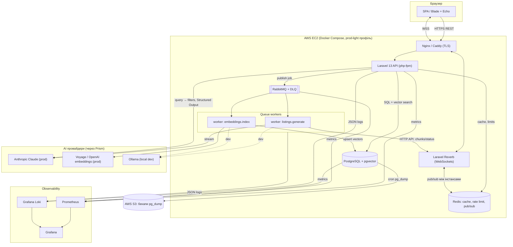

# Перший крок
У ролі **`[architect]`**:
1. Запропонуй високорівневу архітектуру системи (діаграма Mermaid, що показує взаємодію Laravel 13, PostgreSQL+pgvector, RabbitMQ, Redis, Reverb, Grafana Loki, Ollama/Anthropic та хмарної частини AWS EC2 + S3).
2. Склади оптимальну структуру директорій проєкту (модулі Laravel 13 + папки `/docker`, `/terraform`, `/k8s`, `.github/workflows`, `.gitlab-ci.yml`).
3. Розпиши покроковий план задач на **Тиждень 1** для запуску MVP під WSL2 (Ubuntu), включно з інструкцією щодо безпечного старту в AWS Free Tier та налаштування GitLab Mirroring.
---
 
# Dwellio — архітектура v0.2
 
Оновлено: 2026-11-16. Корінь проєкту: `~/projects/test-tasks/ai/dwellio` (у контейнері — `/var/www/html`).
Стек: PHP 8.4, Laravel 13 (вийшла 17.03.2026, мінімум PHP 8.3). Машина розробки: 16 ГБ RAM, Windows 11 + WSL2.
 
## 0. Поправки до початкових припущень
 
1. **AWS Free Tier уже не «12 місяців t2.micro».** Акаунт буде новий, тож діє кредитний Free Plan: $100 при реєстрації + до $100 за ознайомчі завдання, строк — 6 місяців або до вичерпання кредитів, після чого акаунт закривається, якщо не перейти на Paid plan. Висновок: акаунт створюємо на тижні 3–4, коли є що деплоїти.
2. **Pull-mirroring GitHub → GitLab недоступний на GitLab Free** (pull — лише Premium/Ultimate; безкоштовний тільки push з GitLab назовні). Заміна: job у GitHub Actions, який робить `git push` у GitLab після кожного коміту в `main`; GitLab CI стартує від цього пушу.
3. **Повний стек не вміститься в 1 ГБ RAM.** На EC2 йде профіль `prod-light` без локального observability (метрики й логи — у Grafana Cloud Free або лише локально/в k3d). Альтернатива — `t3.small` (2 ГБ) коштом кредитів; ціни перевірити в калькуляторі AWS.
4. **Laravel 13 має власний Laravel AI SDK і вбудовані можливості векторного пошуку.** Вибір «Prism чи Laravel AI SDK» фіксуємо окремим ADR на день 4 (див. розділ 5).
## 1. Високорівнева архітектура
 

 
## 2. Ключові рішення і trade-offs
 
| Рішення | Чому | Альтернатива і її ціна | При 100× |
|---|---|---|---|
| Модульний моноліт | Один деплой, чіткі межі модулів | Мікросервіси — оверхед без команди | Виносимо воркери й Reverb в окремі поди |
| RabbitMQ для AI-задач | DLQ, routing, ack/retry | Redis-черги простіші й для такого обсягу достатні | Окремі черги + HPA за довжиною черги |
| pgvector (HNSW) | Вектори й SQL-фільтри в одному запиті, одна БД | Qdrant — швидший, але +сервіс і синхронізація | RDS + read replica; після мільйонів векторів — окремий vector store |
| Hybrid search | Вектор + FTS, злиття через RRF, жорсткі фільтри у `WHERE` | Лише вектор — губить точні умови | Кеш ембедингів запитів у Redis |
| Reverb + стрімінг з воркера | HTTP-запит не тримає з'єднання з LLM | SSE простіший, але займає php-fpm воркер на весь стрім | Reverb горизонтально через Redis pub/sub |
 
**Пастки, закладені в дизайн**
 
- **Розмірність ембедингів.** Колонка `vector(N)` фіксована; локальна модель в Ollama і прод-модель мусять мати однакову розмірність (наприклад, `bge-m3` локально і прод-модель на 1024 — перевірити актуальні значення). Поруч із вектором зберігаємо `embedding_model`.
- **Українська в FTS.** Вбудованого словника в Postgres немає: `simple` + `pg_trgm`, семантику закриває вектор.
## 3. Структура директорій
 
```text
dwellio/
├── app/
│   ├── Modules/
│   │   ├── Listings/            # квартири, CRUD, фільтри
│   │   │   ├── Actions/  DTO/  Models/  Http/  Policies/
│   │   ├── Search/              # парсинг запиту, hybrid search, RRF
│   │   │   ├── Actions/  DTO/  Queries/  Http/
│   │   ├── Generation/          # оголошення OLX / rieltor.ua
│   │   │   ├── Actions/  DTO/  Jobs/  Events/  Prompts/  Http/
│   │   └── AI/                  # обгортка над LLM-клієнтом, облік токенів, ліміти
│   │       ├── Contracts/  Services/  Middleware/
│   └── Shared/                  # ValueObjects, Exceptions, Logging
├── config/  database/  routes/
├── tests/
│   ├── Feature/  Unit/  Architecture/
├── docker/
│   ├── php/  nginx/  postgres/  rabbitmq/
│   ├── prometheus/  loki/  grafana/
├── compose.yaml                 # dev через Sail (profiles: obs, ollama)
├── compose.prod.yaml            # prod-light для EC2
├── terraform/
│   ├── modules/{ec2,network,s3_backup,iam}/
│   └── envs/prod/
├── k8s/
│   ├── base/                    # Deployment, Service, Ingress, ConfigMap, PVC, HPA
│   └── overlays/{local,prod}/   # kustomize
├── .github/workflows/{ci.yml,mirror-gitlab.yml}
├── .gitlab-ci.yml
├── docs/{architecture.md,adr/,openapi.yaml}
├── phpstan.neon  Makefile  README.md
```
 
Межі модулів фіксують Pest Architecture tests: `Search` не імпортує `Generation`, а LLM-клієнт викликається лише з модуля `AI`.
 
## 4. План на тиждень 1 (WSL2 Ubuntu, усі команди — через Sail)

> Огляд усіх 6 тижнів — у [`docs/roadmap.md`](roadmap.md).
 
**День 1 — середовище**
- `.wslconfig` (16 ГБ RAM на машині): `memory=10GB`, `swap=4GB`, `processors` — половина ядер. Windows лишається ~6 ГБ.
- Laravel 13 + Sail у `~/projects/test-tasks/ai/dwellio`; `compose.yaml` з Postgres (`pgvector/pgvector`), Redis, RabbitMQ. Observability та Ollama — в окремих `profiles`.
- Larastan (рівень 8 → max), Pint, Pest, `Makefile`.

**День 2 — CI і дзеркало**
- `ci.yml`: Pint → PHPStan → Pest.
- GitLab Free: порожній проєкт, Project Access Token у GitHub Secrets, `mirror-gitlab.yml` з `git push --force` у GitLab.
- `.gitlab-ci.yml` з тими самими стадіями.

**День 3 — домен**
- Міграції: `listings`, `listing_embeddings` (`vector`, HNSW-індекс, `embedding_model`), сидер на 200–500 квартир.
- CRUD через Actions + DTO, перші Feature-тести.

**День 4 — AI-шар**
- ADR: Prism чи Laravel AI SDK. Драйвер через `.env` (Ollama локально, Fake у тестах).
- Job `IndexListingEmbedding` через RabbitMQ: retry з backoff, DLQ, ідемпотентність за хешем тексту.

**День 5 — пошук**
- `ParseSearchQuery` (Structured Output → DTO фільтрів) + hybrid search з RRF.
- Тести: невалідний JSON від LLM, порожній результат, падіння провайдера → fallback на чисті SQL-фільтри.

**День 6 — генерація і real-time**
- `GenerateListingAd` job → стрімінг → broadcast у приватний канал Reverb (чанки батчами по ~100 мс).
- Мінімальна сторінка з Echo.

*Як реалізовано (2026-11-26):*
- Потік: `POST /api/listings/{id}/ads` → запис `listing_ads` (queued) + Job у черзі `generation` → `202` з одноразовим токеном. Браузер підписується на `private-listing-ads.{uuid}` (guard `ad-token`, `POST /api/broadcasting/auth`), отримує `ad.started` / `ad.chunk` (`attempt`, `seq`) / `ad.completed` / `ad.failed`, фінальний текст бере `GET /api/listing-ads/{uuid}`. Джерело істини — БД, WebSocket нічого не гарантує.
- Воркер публікує події в Reverb через HTTP API (Pusher-протокол); Reverb одразу запущено зі scaling через Redis pub/sub, тож на тижні 4 досить збільшити `replicas`.
- Кожен процес — окремий контейнер: `reverb`, `worker-embeddings`, `worker-generation` (профіль `workers`).
- Ланцюжок таймаутів (має строго зростати, інакше деплой обриває стрім і RabbitMQ доставляє Job повторно = повторна оплата токенів):

| Ланка | Значення |
|---|---|
| LLM (`AI_GENERATION_TIMEOUT`, він же Guzzle `read_timeout` для стрімів) | 180 с |
| `GenerateListingAdJob::$timeout` (`failOnTimeout = true`) | 240 с |
| `queue:work --timeout` | 270 с |
| `stop_grace_period` у Compose / `terminationGracePeriodSeconds` у k8s | 300 с |
| TTL lock `WithoutOverlapping` | 300 с |

- AMQP heartbeat вимкнений навмисно: PHP-воркер синхронно читає стрім і не встигав би відповідати на heartbeat. `consumer_timeout` RabbitMQ (30 хв) > життя Job (15 хв).

*Known issues Дня 6:*
- Ліміти OLX / rieltor.ua у `Platform` не звірені з правилами майданчиків.
- `qwen2.5:3b` погано тримає формат і може вигадувати факти; у UI є попередження «перевірте факти».
- У повідомленнях scaling-каналу Redis Reverb передає серіалізований `Application` **разом із secret** → Redis у проді лише в приватній мережі й із паролем.
- CRUD квартир і запуск генерації без автентифікації (є лише throttle 5/хв на IP і 200/день глобально).
- Exactly-once немає: падіння воркера між відповіддю LLM і записом у БД = повторна оплата.

**День 7 — безпека і документація**
- Rate limiting і облік токенів у Redis, README з діаграмою, ADR-001…004.
- AWS цього тижня — лише підготовка: каркас Terraform (`terraform validate` без акаунта) і чеклист старту на тиждень 3–4.

*Як реалізовано (2026-11-26):*
- **Бюджет токенів:** контракт `AI\Contracts\TokenBudget` + `CacheTokenBudget` (Redis, атомарний `INCRBY`, ключі `ai:tokens:{Y-m-d UTC}:{purpose}:{input|output|calls}`, TTL 3 доби). Окремі денні ліміти на `embeddings` / `query_parsing` / `generation` (`AI_BUDGET_*_DAILY`). Кожен AI-контракт резолвиться в `Budgeted*Client`-декоратор над адаптером або Fake: перевірка ДО виклику, облік ПІСЛЯ. `StructuredOutputClient` тепер повертає DTO `StructuredOutput` з токенами.
- **Поведінка при вичерпанні:** пошук — fallback без LLM / без вектора; `POST /ads` — `503` + `Retry-After` до півночі UTC (перевірка до постановки Job); Job-и генерації та індексації — одразу `failed` без ретраїв (`AdFailure::BudgetExceeded`, DLQ), індексацію наздоганяє `listings:reindex`.
- **Rate limit пошуку:** `throttle:search`, 30/хв на IP (`SEARCH_RATE_PER_MINUTE`). `make ai-usage` — таблиця споживання за день.
- **Terraform:** `terraform/modules/{network,iam,ec2,s3_backup}` + `envs/prod` (S3 backend з `use_lockfile`, AWS Budgets). `make tf-validate` у Docker; job `terraform` у GitHub Actions і GitLab CI.
- **Документи:** ADR-001, 002, 003, 005; README з діаграмами Mermaid.

*Known issues Дня 7:*
- Бюджет м'який («перевірив → викликав → дописав»): перевищення до (одночасні виклики × `max_tokens`). Жорсткий варіант — резервування `max_tokens` до виклику.
- Обірваний стрім токенів не повертає (usage приходить у фінальній події) → такі витрати не потрапляють у лічильник, видно лише в логах спроб.
- Ліміти в токенах, а не в грошах: ціни моделей різні, переведення в $ — тиждень 2.

**Чеклист безпечного старту в AWS (тиждень 3–4, новий акаунт на Free Plan)**
1. Реєстрація на Free Plan; root — лише для білінгу, одразу MFA.
2. IAM Identity Center або IAM-користувач із least privilege для Terraform; жодних access keys у root.
3. AWS Budgets: алерт на витрату кредитів (поріг $1 фактичних витрат + алерти на 50/80% кредитів).
4. Remote state Terraform у S3 з шифруванням і versioning.
5. `terraform destroy` після демо, щоб кредитів вистачило на всі 6 місяців.
## 5. Відкриті питання (ADR)
 
- ~~ADR-001: модульний моноліт.~~ Прийнято.
- ~~ADR-002: RabbitMQ проти Redis-черг.~~ Прийнято.
- ~~ADR-003: pgvector проти окремого vector store.~~ Прийнято.
- ~~ADR-004: Prism проти Laravel AI SDK (Laravel 13).~~ Прийнято.
- ADR-005: Reverb і стрімінг із воркера (номер зайнято на Дні 6, див. `docs/adr/README.md`).
- ADR-006: `t3.micro` + swap проти `t3.small` на кредитах (тиждень 3).
## Джерела
 
- AWS: https://aws.amazon.com/about-aws/whats-new/2025/07/aws-free-tier-credits-month-free-plan
- GitLab mirroring: https://docs.gitlab.com/17.2/ee/user/project/repository/mirror
- Laravel 13 release notes: https://laravel.com/docs/13.x/releases
